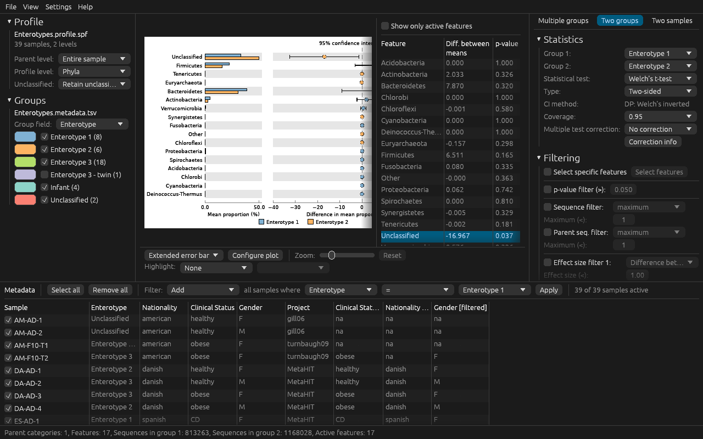
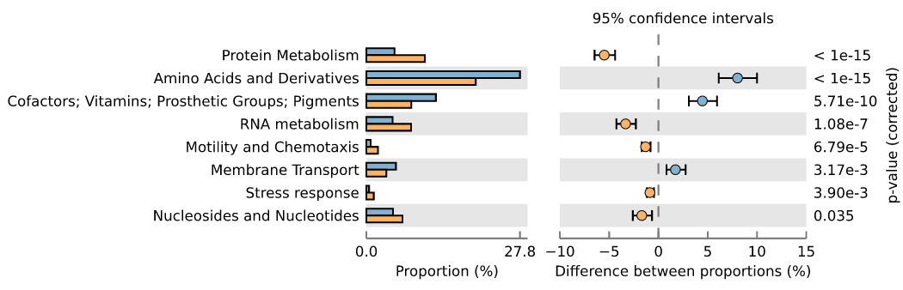
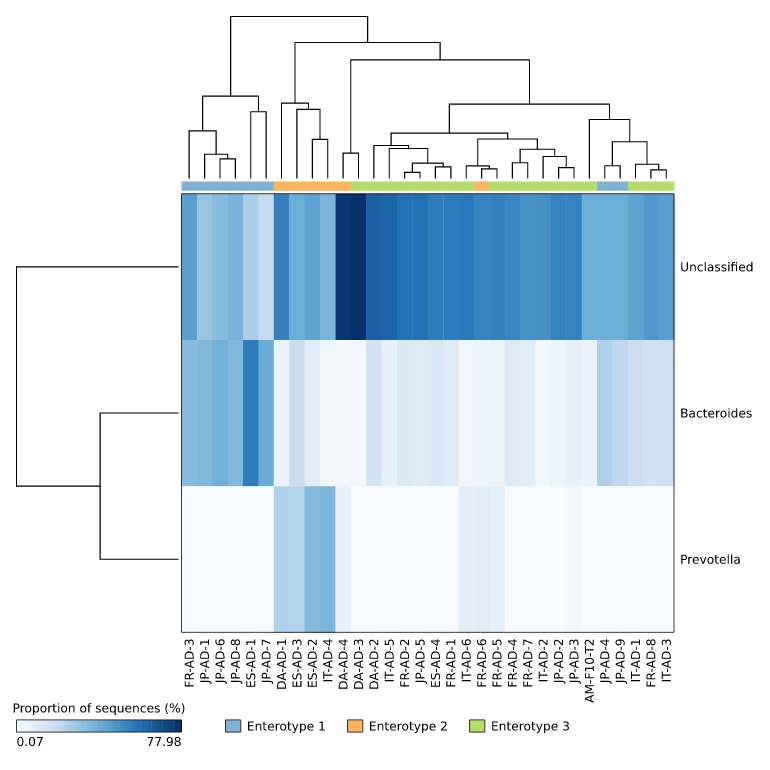

# STAMP

[](https://pypi.python.org/pypi/stamp)
[](https://pepy.tech/project/stamp)

STAMP is a software package for analyzing taxonomic or metabolic profiles that promotes ‘best practices’ in choosing appropriate statistical techniques and reporting results. Statistical hypothesis tests for pairs of samples or groups of samples is support along with a wide range of exploratory plots. STAMP encourages the use of effect sizes and confidence intervals in assessing biological importance. A user friendly, graphical interface permits easy exploration of statistical results and generation of publication quality plots for inferring the biological relevance of features in a metagenomic profile. STAMP is open source, extensible via a plugin framework, and available for all major platforms.

STAMP can be obtained from the [Releases](https://github.com/dparks1134/STAMP/releases) page of this GitHub repository.

Further information, including installation and user documentation, can be found [here](https://beikolab.cs.dal.ca/software/STAMP).

The STAMP Google Group can be found [here](https://groups.google.com/forum/?hl=en#!forum/stamp_help).

## Rust port (in progress)

STAMP is being ported from Python to Rust, to run as a standalone application on Linux, Windows and macOS and in the browser. The port is not yet usable; STAMP v2 on the Releases page remains the current version.

- `crates/stamp-core`: data model, file parsers and statistics
- `crates/stamp-plot`: plots, with PNG, SVG and PDF export
- `crates/stamp-cli`: command-line interface
- `crates/stamp-gui`: graphical application (egui), for desktop and browser
- `legacy/`: the Python implementation, kept as the reference
- `tests/golden/`: reference outputs generated from the Python implementation
- `docs/CHANGES_FROM_PYTHON.md`: deliberate differences from STAMP v2

Build and test with `cargo build --workspace` and `cargo test --workspace`. Packaging, continuous integration and the release procedure are described in [docs/RELEASING.md](docs/RELEASING.md).

### Graphical application

The desktop application is built with `cargo build --release -p stamp-gui`; the binary is `target/release/stamp`. A profile and its metadata can be opened from the File menu or named on the command line:

```bash
target/release/stamp examples/EnterotypesArumugam/Enterotypes.profile.spf \
                     examples/EnterotypesArumugam/Enterotypes.metadata.tsv
```



It offers the three kinds of analysis of STAMP v2 (multiple groups, two groups, two samples) and a fourth, correlation with a numeric metadata field; every statistical test, correction and filter, all the plots with tooltips, a results table, export of plots (PNG, SVG, PDF) and tables, and conversion from the other file formats. It is new: the browser version has been tried by hand, but the desktop window has so far been exercised only through automated tests.

### In the browser

The same application runs in a web browser, compiled to WebAssembly. Everything is computed on your own computer: no data is uploaded, and the site is just static files that any web server can host.

```bash
cargo install trunk --locked     # once
cd crates/stamp-gui
trunk build --release            # writes the site to crates/stamp-gui/dist
trunk serve --release            # or: build and open it at http://127.0.0.1:8080
```

In the browser, files are opened with the browser's file picker and results are saved as downloads. File > Open example data loads one of two built-in datasets. Analyses run on the page's single thread, a few features at a time, so the page keeps responding and shows progress during a long resampling test; White's test is the exception and holds the page until it finishes.

### Command line

The statistics and file converters are usable now through `stamp-cli` (build it with `cargo build --release -p stamp-cli`; the binary is `target/release/stamp-cli`). Results are written as tab-separated tables with the same column headings as STAMP v2.

```bash
# What is in a profile?
stamp-cli info --profile examples/EnterotypesArumugam/Enterotypes.profile.spf \
               --metadata examples/EnterotypesArumugam/Enterotypes.metadata.tsv

# Two samples: Fisher's exact test with Benjamini-Hochberg correction
stamp-cli two-samples --profile examples/IronMineEdwards/EdwardsIronMine.spf \
    --sample1 Red --sample2 Black --profile-level Subsystem \
    --correction benjamini-hochberg --significance 0.05 --output iron_mine.tsv

# Two groups: Welch's t-test, keeping features that differ by at least 1%
stamp-cli two-groups --profile examples/EnterotypesArumugam/Enterotypes.profile.spf \
    --metadata examples/EnterotypesArumugam/Enterotypes.metadata.tsv --field Enterotype \
    --group1 "Enterotype 1" --group2 "Enterotype 3" --effect-size-filter diff-between-prop=1

# Several groups: ANOVA, then a post-hoc test on one feature
stamp-cli multi-groups --profile examples/EnterotypesArumugam/Enterotypes.profile.spf \
    --metadata examples/EnterotypesArumugam/Enterotypes.metadata.tsv --field Enterotype \
    --group "Enterotype 1" --group "Enterotype 2" --group "Enterotype 3"
stamp-cli post-hoc --profile examples/EnterotypesArumugam/Enterotypes.profile.spf \
    --metadata examples/EnterotypesArumugam/Enterotypes.metadata.tsv --field Enterotype \
    --group "Enterotype 1" --group "Enterotype 2" --group "Enterotype 3" --feature Bacteroides

# Paired samples: Wilcoxon signed-rank test, pairs named by a metadata field
stamp-cli two-groups --profile profile.spf --metadata metadata.tsv --field Treatment \
    --group1 Before --group2 After --test wilcoxon --pair-field Subject

# Correlation of every feature with a numeric metadata field
stamp-cli correlation --profile profile.spf --metadata metadata.tsv --field Depth \
    --method spearman --correction benjamini-hochberg --plot depth.png

# Convert another tool's output to a STAMP profile
stamp-cli convert mgrast examples/CowRumen-MG-RAST/CowRumen-MG-RAST.tsv --output cow_rumen.spf
```

The two-sample and two-group commands can also draw the filtered results as an extended error bar plot, as PNG, SVG or PDF:

```bash
stamp-cli two-samples --profile examples/IronMineEdwards/EdwardsIronMine.spf \
    --sample1 Black --sample2 Red --profile-level Classification \
    --correction bonferroni --significance 0.05 --plot iron_mine.png
```



`--plot-type` selects any of the other plots: `bar`, `box`, `profile-bar`, `scatter`, `sequence-histogram`, `p-value-histogram`, `multiple-comparison`, `pca`, `heatmap`, `rarefaction`, `volcano`, `composition`, `alpha-diversity`, `pcoa`, `distance-box`, (with the `correlation` command) `correlation-scatter` and (with the `post-hoc` command) `post-hoc`. For example, a clustered heatmap of the genera that differ between three enterotypes:

```bash
stamp-cli multi-groups --profile examples/EnterotypesArumugam/Enterotypes.profile.spf \
    --metadata examples/EnterotypesArumugam/Enterotypes.metadata.tsv --field Enterotype \
    --group "Enterotype 1" --group "Enterotype 2" --group "Enterotype 3" \
    --correction benjamini-hochberg --significance 0.05 --plot enterotypes.png
```



Run `stamp-cli <command> --help` for every option. Resampling methods take `--seed`, so a run can be repeated exactly.

## License

STAMP is open source and released under the GNU General Public License v3.0. See LICENSE for further details.
