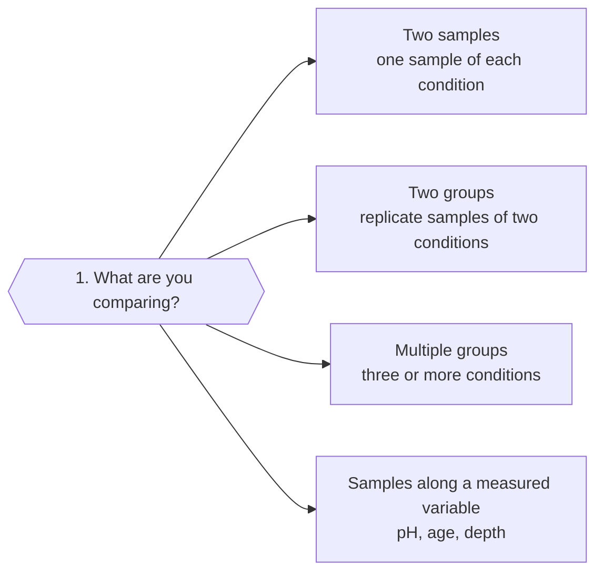
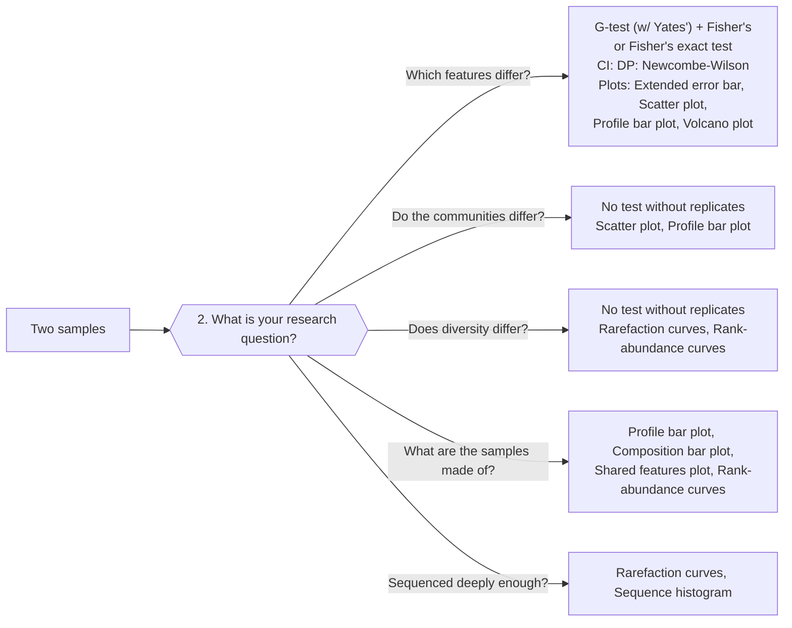
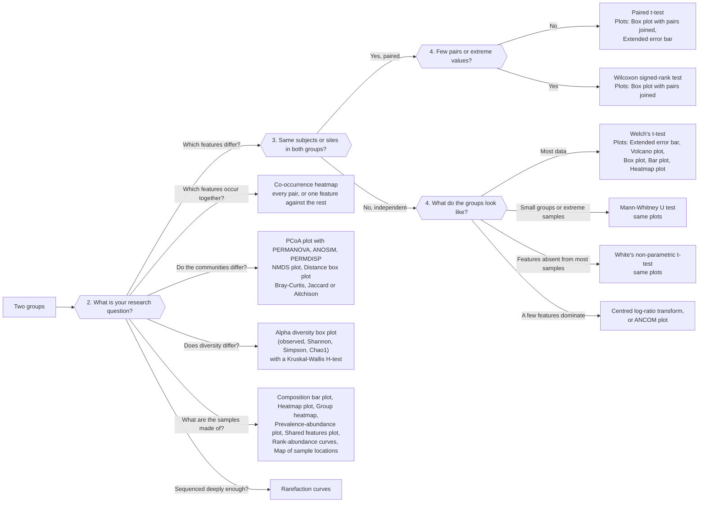
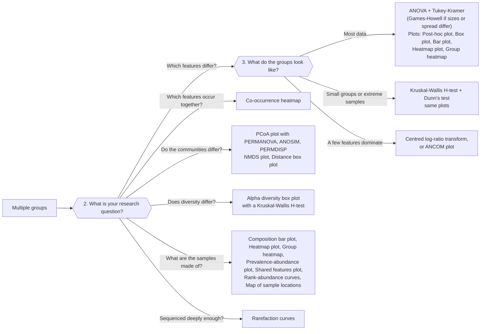
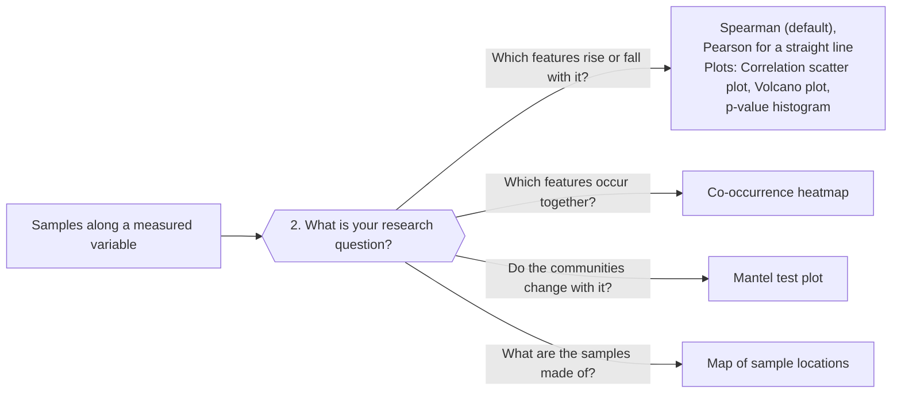

# Test selection wizard: flow chart and gaps

Status (2026-11-24): flow chart agreed (comparison first), the dead ends
it found filled, and **the wizard built** (`crates/stamp-gui/src/wizard.rs`
for the questions and recommendations, `wizard_ui.rs` for the window;
user documentation in `docs/site/wizard.rst`). Not built: the "At a
glance" table view described below.

A wizard that leads someone from the question they want answered to the
analysis, test and plots in STAMP that answer it. This file holds the flow
chart, the rule that decides which choices can be selected for the loaded
data, and the tests and plots that guides of this kind offer and STAMP
lacks.

## How such guides are structured

Sources read: Research Gold's decision guide and Statistical Analysis
Help's guide (the two named by the owner), GraphPad's table from *Intuitive
Biostatistics*, UCLA OARC's "Choosing the correct statistical test", the
CTTIR decision assistant, and Leeds University Library's guide.

- All ask the same things in nearly the same order: **the research
  question** (compare, relate, predict; some add describe), **the kind of
  data**, **how many groups**, **paired or independent**, and last **whether
  the assumptions hold**, which picks between a test and its rank-based
  alternative.
- They are either a click-through of three to five questions (CTTIR) or one
  lookup table of goal against data type (GraphPad, UCLA).
- The better ones end on more than a name: the recommended test, a
  paragraph of reasoning, its assumptions, the alternative if they fail,
  and what to report (the effect size beside the p-value).
- Devices: a breadcrumb of the answers so far, Back and Start over. None of
  those read uses pictures on the choices, information buttons or greyed-out
  choices, and almost none name a plot; these are where STAMP's can be
  better.
- GraphPad warns against choosing a rank-based test from a normality test
  alone; the last question is better put as something the user can see
  (small groups, extreme samples, many zeros) and STAMP can count.

What differs in STAMP: the kind of data is fixed (every feature is a
proportion of a sample's sequences), so that question disappears, and half
of what STAMP offers concerns the community as a whole, which general
guides do not cover. The first question therefore has more answers than
"compare, relate, predict".

## Order of the first two questions

Decided by the owner (2026-11-24): **the comparison first, the research
question second**. The first step asks what is compared, the second what
the user wants to know about it, in the guides' words ("What is your
research question?"). Every question is drawn under every comparison; the
ones a comparison cannot answer are greyed with the reason.

## Flow chart

Step 1 for every path:

Step 2, the questions and whether each comparison can answer them:

| 2. What is your research question? | Two samples | Two groups | Multiple groups | Measured variable |
| --- | --- | --- | --- | --- |
| Which features differ? | yes | yes | yes | greyed: "there are no groups to compare" |
| Which features rise or fall with the variable? | greyed | greyed | greyed | yes |
| Which features occur together? | greyed: "needs many samples" | yes | yes | yes |
| Do the communities differ as a whole? | plots only, no test | yes | yes | yes |
| Does diversity differ? | plots only, no test | yes | yes | yes (Alpha diversity scatter plot) |
| What are the samples made of? | yes | yes | yes | yes |
| Were the samples sequenced deeply enough? | yes | yes | yes | greyed |

### Two samples

### Two groups

### Multiple groups

### Samples along a measured variable

Every per-feature result (two samples, two groups, multiple groups,
correlation) also gets the Benjamini-Hochberg FDR as the default
correction, an effect size with its confidence interval, and the p-value
histogram as a check.

The question "What do the groups look like?" is answered by STAMP where it
can be: it knows the size of each group, how many features are zero in most
samples, and whether a few features hold most of the sequences, so it marks
one answer "Suggested for your data" with the numbers behind it. The user
can still choose another.

Tests in STAMP that no path recommends, and why: *t-test (equal variance)*
(Welch's is as good when variances are equal and safer when not);
chi-square, chi-square with Yates', G-test, G-test with Yates', difference
between proportions, hypergeometric, bootstrap and permutation for two
samples (the default and Fisher's exact test cover their uses); Scheffé and
Welch's (uncorrected) post-hoc tests; the Bonferroni, Šidák, Holm and
Storey corrections. They stay in the Statistics frame, and the result page
names the relevant ones under "Alternatives".

## What each step shows

1. **Comparison** (four cards: two samples, two groups, multiple groups,
   samples along a measured variable): drawn as columns of sample dots.
2. **Research question** (seven cards): a small drawing of the answer
   (bars with a bracket for "differ", a scatter with a line for "rise or
   fall", a small matrix for "occur together", two clouds of points for
   "communities", box plots for "diversity", a stacked bar for "made of",
   a levelling curve for "deep enough").
3. **Design and data** (one or two questions, only on the paths above).
4. **Result**: the analysis, test, post-hoc test, correction and plots,
   one paragraph of why, the alternatives, what to report, and a button
   that sets the analysis up and shows the first plot.

Beside the click-through, an **"At a glance" table** in the manner of the
"Which statistical test should you use?" poster the owner sent: one row per
test with its small drawing, when to use it, what it does and what it
assumes, the rows that the loaded data cannot support greyed. The poster's
layout (goal across the top, yes/no questions beneath, test at the bottom)
is the chart above turned on its side, and its goals map onto the first
two steps: "compare two groups" and "compare more than two groups" are
the comparison with "Which features differ?", "relationship between
variables" is the measured-variable and co-occurrence questions,
"categorical data" is the presence-or-absence gap below, and "prediction
or modelling" is the linear-model gap below.

Every card has an "i" button that opens a short explanation with an
example ("gut samples from the same people before and after a diet are
paired"). A breadcrumb of the answers, Back and Start over are always
shown.

## What can be selected

Every card is always drawn. A card that the loaded data cannot support is
greyed, cannot be chosen, and says why in one line.

| Choice | Selectable when | Otherwise says |
| --- | --- | --- |
| Two samples | the profile has 2 or more samples | "Load a profile" |
| Two groups | a metadata field has 2 values with 2 or more samples each | "Needs metadata that puts samples in groups" |
| Multiple groups | a metadata field has 3 or more values | "Needs a metadata field with three or more groups" |
| Along a measured variable; "rise or fall with a measured variable" | a metadata field is numeric | "Needs a numeric metadata field (pH, age, depth)" |
| Paired | a metadata field names each pair once in each group | "Needs a metadata field that identifies the pairs" |
| Rarefaction curves, Chao1 | the profile holds whole sequence counts | "Needs sequence counts, not proportions" |
| Map of sample locations | latitude and longitude fields | "Needs latitude and longitude in the metadata" |
| Communities or diversity differ, with a test | groups (not two single samples) | still selectable; the result says no test is possible without replicates |

## Gaps: what such guides offer that STAMP lacks

Found by setting the tests each guide can recommend against STAMP's, and by
walking the chart for dead ends. Ordered by how much the wizard needs them.

### Dead ends in the chart

**All filled (2026-11-24)**, on the owner's choice "dead ends only"; each is
described in `NEW_FEATURES.md`. In the chart: "Same subjects in every
group?" for multiple groups now leads to the Friedman test with the
Wilcoxon signed-rank (Holm) post-hoc test; "Which features differ?" gains
an answer "found in more samples of one group" that leads to Fisher's exact
test, McNemar's test (paired) or the chi-square test of presence, with the
Prevalence-abundance plot; "Do the communities differ?" for multiple groups
ends on pairwise PERMANOVA as well; "Which features occur together?" ends
on the heatmap and its scatter view; and "Does diversity differ?" along a
measured variable leads to the Alpha diversity scatter plot.

| Missing | Where the wizard needs it | Size |
| --- | --- | --- |
| **p-value histogram in the two-group and multiple-group analyses** | The chart sends every per-feature result to it as a check, but `PlotKind::available` offers it only for two samples and correlation | small |
| **Friedman test** (three or more matched groups), with a paired post-hoc test | "Same subjects in every group?" has no answer for multiple groups; every guide read has this row (time series on the same subjects are common) | medium |
| **Presence or absence between groups**: Fisher's exact test (two groups), chi-square (multiple), McNemar's (paired) on how many samples of each group hold a feature | The "categorical data" branch of every guide; the Prevalence-abundance plot shows prevalence but nothing tests it | medium |
| **Pairwise PERMANOVA** between groups, corrected | "Communities differ" for multiple groups ends on one overall p-value with no "which groups?", unlike ANOVA with its post-hoc tests | small |
| **Alpha diversity against a measured variable** (scatter with a correlation) | "Does diversity differ?" is greyed for a measured variable: the Alpha diversity box plot exists only for groups | small |
| **Feature against feature scatter plot** | "Which features occur together?" ends on a heatmap of coefficients; there is no plot of the two features themselves | small |

### Assumption checks (the last question of every guide)

| Missing | Use | Size |
| --- | --- | --- |
| **Q-Q plot and histogram of a feature's residuals**, by group | Lets the user see "extreme samples" instead of taking it on trust | small |
| **Levene's (Brown-Forsythe) test** of equal spread | Decides Tukey-Kramer or Games-Howell; reported, not used to switch tests silently | small |
| **Welch's ANOVA** | The overall test that belongs with Games-Howell when spread differs; STAMP has the post-hoc test without it | small |
| **Shapiro-Wilk test** | Named by the guides; of little use over thousands of features and GraphPad advises against choosing by it. A summary ("31% of features depart from normal") at most | small, low value |

### "Prediction" and adjusting for a second variable

| Missing | Use | Size |
| --- | --- | --- |
| **Linear model of a feature on several metadata fields** (multiple regression, ANCOVA, two-way ANOVA) | "Do the groups differ once age or batch is accounted for?": the third research question of every guide, and STAMP's largest gap against them | large |
| **PERMANOVA with a second factor or within blocks (strata)** | The same adjustment at the level of the community | medium |
| **Constrained ordination (db-RDA) or fitted variables on a PCoA** | "Which measured variables explain the communities?"; already noted in `docs/ROADMAP.md` as worthwhile later | large |
| **Classifier (random forest or logistic regression) with cross-validation** | "Can the profile predict the group?" | large; arguably outside STAMP |

### Smaller additions

| Missing | Use |
| --- | --- |
| **Standardised effect sizes**: Cohen's d or Hedges' g, rank-biserial correlation (Mann-Whitney, Wilcoxon), epsilon-squared (Kruskal-Wallis) | Each guide's "what to report" names these; STAMP reports differences and ratios of proportions and eta-squared |
| **Kendall's tau** | The usual third correlation, better with many ties (zeros) |
| **Trend across ordered groups** (Jonckheere-Terpstra) | Groups with an order (dose, time point, disease stage) |
| **Co-occurrence network plot** | The usual picture for "which features occur together" in microbiome tools |
| **Sample size and power** | In several guides; a different kind of tool, suggested to leave out |

Not applicable to profiles, and left out: one-sample tests against a fixed
value, survival analysis (log-rank, Cox, Kaplan-Meier), factor analysis,
canonical correlation, discriminant analysis.

## Sources

- https://researchgold.org/blog/choosing-right-statistical-test-research
- https://statisticalanalysishelp.com/how-to-choose-the-right-statistical-test/
- https://www.graphpad.com/support/faqid/1790/
- https://stats.oarc.ucla.edu/other/mult-pkg/whatstat/
- https://cttir.github.io/tutorials/decision-tree/
- https://library.leeds.ac.uk/info/14012/mathematics-and-statistics/212/statistical-tests/2
