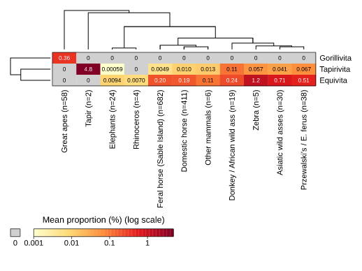
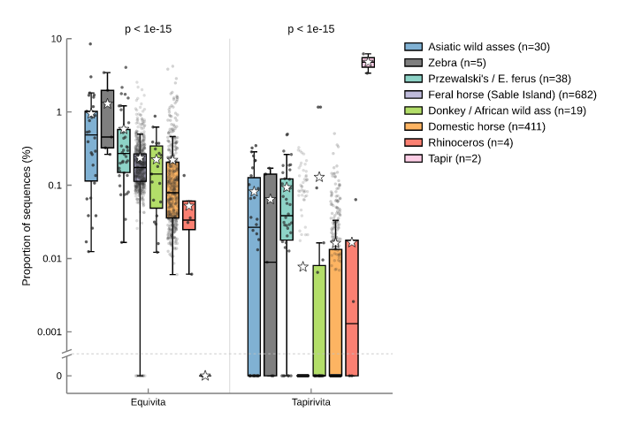
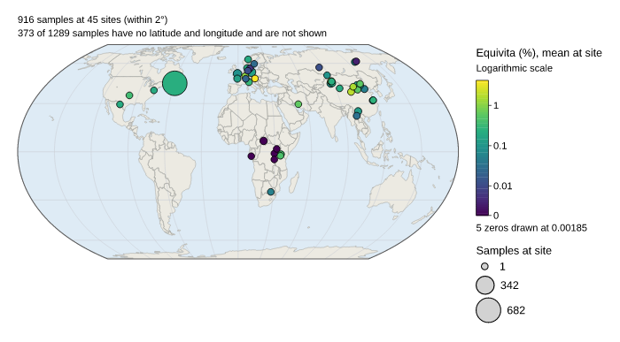
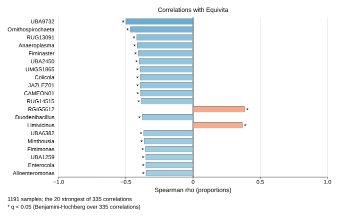

Example: Eggerthellaceae gut symbionts
=======================================

This example works through a larger, real data set that comes with STAMP:
1,289 gut metagenomes from the Sequence Read Archive in which the
Eggerthellaceae genera *Equivita*, *Gorillivita* or *Tapirivita* were found.
These bacteria live in the guts of mammals and were described by Parks et
al. (2026, *Microbial Genomics* 12(8), doi:10.1099/mgen.0.001767);
*Equivita* and *Gorillivita* read the stop codon UGA as tryptophan (genetic
code 4), *Tapirivita* uses the standard code. The questions are the ones a
study of a new group of symbionts asks: which hosts carry each genus, how
abundant it is in them, where the samples come from, and which other
bacteria it is found with.

The data
--------

The profiles were made by SingleM and taken from Sandpiper
(``https://sandpiper.qut.edu.au``, GTDB R232), as described in
:ref:`singlem-profiles`; the host, captivity and location of each sample
were curated from its NCBI BioSample record. The files are in
``examples/Eggerthellaceae`` of the source repository, with a ``readme.txt``
that says how they were made:

``eggerthellaceae.spf``
   The whole community, Domain to Genus, of each BioSample: 475 genera
   common enough to matter and the three focus genera, with the rest of each
   phylum in an ``unclassified other <phylum>`` row so that sample totals
   are kept.
``eggerthellaceae_mgr_species.spf``
   The species of the three genera (from GlobDB, which separates more of
   them than GTDB), with the rest of the community in one row,
   ``unclassified rest of community``. Use it with *Unclassified* set to
   *Use only for calculating frequency profiles*
   (``--unclassified frequency-only``), so that proportions are of the whole
   community.
``eggerthellaceae.metadata.tsv``
   One row per BioSample: BioProject, ``Host_group`` (13 groups),
   ``Host_species``, ``Host_order``, ``Captivity``, ``Country``,
   ``Continent``, ``Latitude`` and ``Longitude``, ``Collection_year``, the
   size of the metagenome, and the percentage of each focus genus.

In the window, **File > Open example data** has both profiles:
**Eggerthellaceae (genera)** and **Eggerthellaceae (focus species)**. They
open in the *Multiple groups* analysis with the samples grouped by
``Host_group``, at the lowest level of the profile (and the focus species
with unclassified coverage used only for proportions); in *Two groups*,
domestic horses are compared with the feral horses of Sable Island.

.. important::

   Three things to keep in mind with these data:

   * The values are **estimated genome coverage, not counts of reads**.
     Proportions, and the tests and plots of groups of samples, are fine;
     rarefaction, Chao1 and the count-based tests of two samples are not
     meaningful, and STAMP refuses the ones that need whole numbers.
   * **One study dominates**: 682 of the 1,289 samples are feral horses of
     Sable Island, Canada. Anything computed over all samples mostly
     describes these horses; use the groups, or a sample filter, to look at
     the other hosts.
   * Samples were chosen *because* they contain a focus genus, and the host
     curation is rule-based; some host groups are small (two tapirs, four
     rhinoceroses).

The commands below are run from the top of the source repository. In the
window, the same plots are in the plot selector beneath the plot, with
their options under **Configure plot**, and ``--where`` is the **Sample
filter** on the left.

Which hosts carry each genus
----------------------------

A heatmap of samples cannot show 1,289 columns (STAMP refuses more than
1,000 samples and says so), but the :ref:`group heatmap
<plot-group-heatmap>` summarises each host group in one column. With the
species profile at genus level the three focus genera are its only
features::

   stamp-cli multi-groups \
       --profile examples/Eggerthellaceae/eggerthellaceae_mgr_species.spf \
       --metadata examples/Eggerthellaceae/eggerthellaceae.metadata.tsv \
       --field Host_group --profile-level Genus --unclassified frequency-only \
       --where-not Host_group=Unknown --where-not Host_group=Environmental \
       --plot genera_by_host.png --plot-type group-heatmap \
       --heatmap-scale log10 --heatmap-values \
       --heatmap-value-format significant --heatmap-value-digits 2

   Mean percentage of each focus genus in each host group, on a log colour
   scale; grey cells are groups in which the genus was never found.

The three genera have different hosts: *Gorillivita* is found only in the
great apes, *Tapirivita* is most abundant in the two tapirs and present at
low levels in horses and their relatives, and *Equivita* is in every group
of the horse family (and the elephants and rhinoceroses), most abundant in
zebras, wild asses and Przewalski's horses. ``--heatmap-statistic
prevalence`` shows instead in what percentage of each group's samples the
genus was found.

How abundant they are in the horse family
-----------------------------------------

A :ref:`box plot of several features <plot-box-features>` on a log axis
shows the spread behind those means. ``--where Host_order=Perissodactyla``
keeps the horses, tapirs and rhinoceroses::

   stamp-cli multi-groups \
       --profile examples/Eggerthellaceae/eggerthellaceae.spf \
       --metadata examples/Eggerthellaceae/eggerthellaceae.metadata.tsv \
       --field Host_group --where Host_order=Perissodactyla \
       --profile-level Genus \
       --plot perissodactyls.png --plot-type box \
       --plot-feature Equivita --plot-feature Tapirivita \
       --box-log --box-points --box-counts --box-group-order median

   *Equivita* and *Tapirivita* in each group of perissodactyls, as a
   percentage of the whole community, on a log axis with zeros drawn below
   the break; stars mark the means.

*Equivita* is in nearly every horse, ass and zebra, mostly at 0.01 to 1% of
the community, and varies a hundredfold between individuals of one group.
*Tapirivita* is absent from most samples of most groups (the boxes reach
down to zero) and abundant only in the tapirs. The p-values above each
panel come from the test across the groups (an ANOVA by default;
``--test kruskal-wallis`` suits these skewed values better), and with groups
this unequal in size the plot says more than the p-value.

Where the samples come from
---------------------------

The :ref:`map <plot-map>` places each sample by its ``Latitude`` and
``Longitude``, one marker per site sized by its number of samples, here
coloured by the mean percentage of *Equivita*::

   stamp-cli multi-groups \
       --profile examples/Eggerthellaceae/eggerthellaceae.spf \
       --metadata examples/Eggerthellaceae/eggerthellaceae.metadata.tsv \
       --field Host_group --profile-level Genus \
       --plot equivita_map.png --plot-type map --map-extent world \
       --color-by feature:Equivita --color-scale log10

   Sites of the 916 samples with coordinates, coloured by the mean
   percentage of *Equivita* at the site.

The large marker off Nova Scotia is Sable Island. Most of the dark markers
in central Africa are great apes, which rarely carry *Equivita*; the samples of
domestic and wild horses in Europe and Asia carry it at up to a few
percent. A third of the BioSamples give no coordinates and are left off the
map (the note above it says how many).

Which bacteria it is found with
-------------------------------

:ref:`Co-occurrence <cli-co-occurrence>` with ``--with`` correlates one
feature with every other feature of the profile and plots the strongest
correlations::

   stamp-cli co-occurrence \
       --profile examples/Eggerthellaceae/eggerthellaceae.spf \
       --metadata examples/Eggerthellaceae/eggerthellaceae.metadata.tsv \
       --where Host_order=Perissodactyla \
       --profile-level Genus --unclassified frequency-only \
       --with Equivita --partners 20 --min-feature-prevalence 10 \
       --plot equivita_partners.png --output equivita_partners.tsv

   The 20 genera whose proportions are most strongly correlated (Spearman)
   with those of *Equivita* across the 1,191 perissodactyl samples.

Most of the strongest correlations are negative: samples rich in
*Equivita* tend to have less of these genera. With this many samples even
weak correlations have tiny q-values, so look at the size of rho (see
:ref:`co-occurrence`); and because most of the samples are from one
population of feral horses, a correlation here may describe that
population rather than horses in general. Adding
``--where-not "Host_group=Feral horse (Sable Island)"`` is a quick check.

``--clr`` (centred log ratios) is often recommended for correlating
proportions, but with features that are absent from most samples, as
*Gorillivita* is from horses, the pseudocount given to the zeros makes
rare features correlate with each other; compare both before trusting
either.

Citing the data
---------------

Please cite Parks et al. (2026) for the genera and this data set, Sandpiper
and SingleM (Woodcroft et al. 2025, *Nature Biotechnology*) for the
profiles, and the original studies of the BioProjects you use (listed in the
``BioProject`` column).
