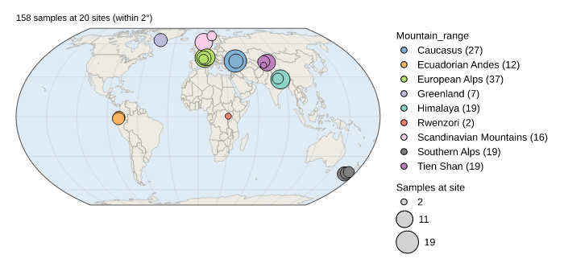
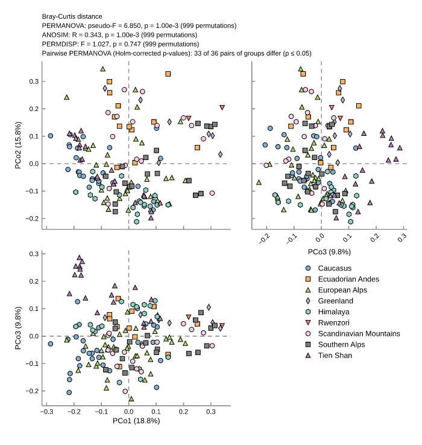
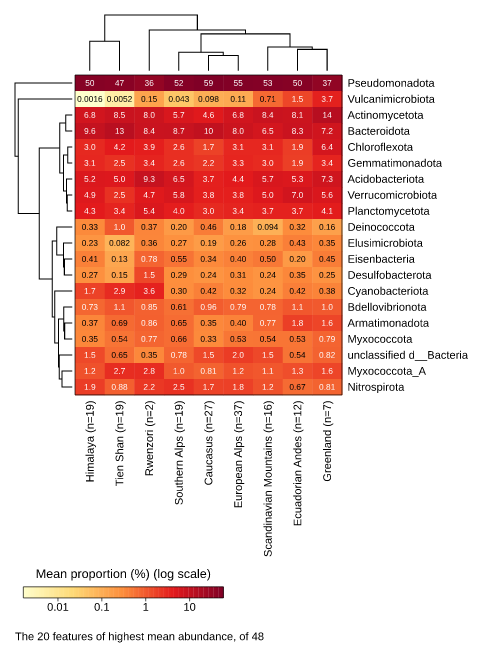
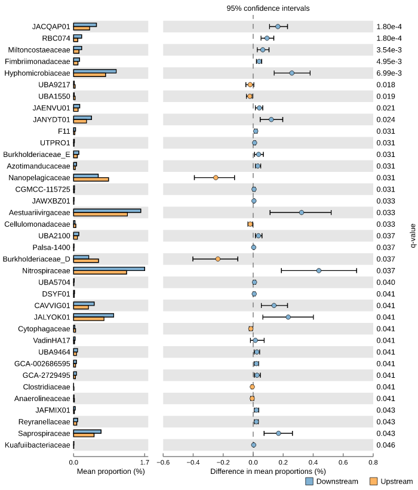
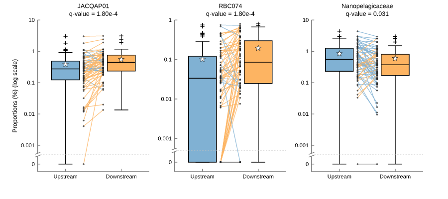
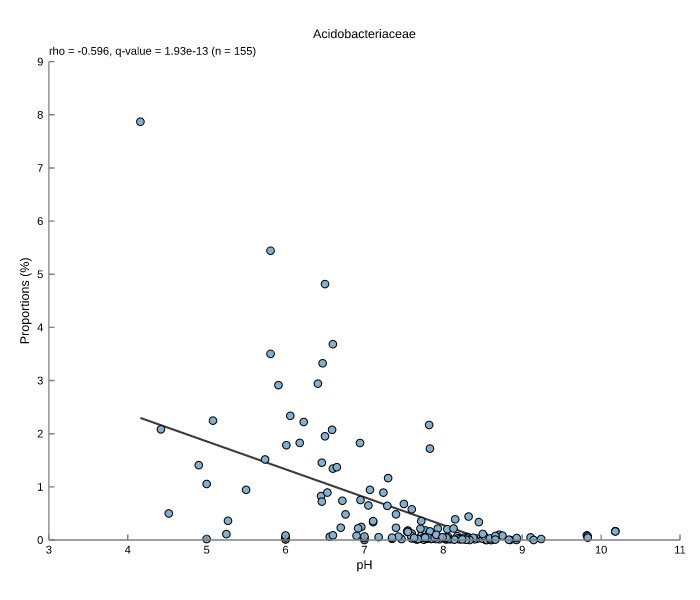
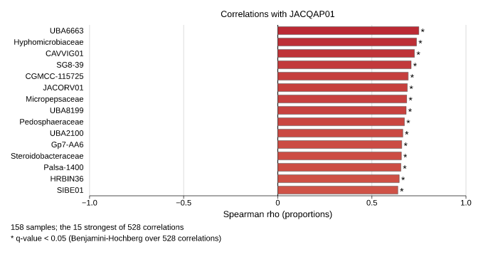

Example: glacier-fed streams
============================

This example works through a larger, real data set that comes with STAMP:
158 metagenomes of the sediment of glacier-fed streams in nine mountain
ranges, from the Vanishing Glaciers project (Michoud et al. 2025, *Nature
Microbiology* 10:217, doi:10.1038/s41564-024-01874-9; Ezzat et al. 2025,
*Nature*, doi:10.1038/s41586-024-08313-z). Each stream was sampled twice:
at an **upstream** reach as close as possible to the glacier snout, and at
a **downstream** reach near the moraine the glacier left at the end of the
Little Ice Age, a few hundred metres further on. The questions are where
the samples come from, whether the mountain ranges differ, which bacteria
change between the two reaches of a stream, and which follow the chemistry
of the water.

The data
--------

The profiles were made by SingleM against GTDB R232, most of them taken
from Sandpiper (``https://sandpiper.qut.edu.au``), as described in
:ref:`singlem-profiles`. The files are in ``examples/GlacierFedStreams`` of
the source repository, with a ``readme.txt`` that says how they were made:

``glacier_streams.spf``
   The whole community of each sample, Domain to Species (78 phyla, 1,392
   families and 5,015 genera with a name).
``glacier_streams.metadata.tsv``
   One row per sample: ``Glacier`` (the same for the two reaches of a
   stream), ``Mountain_range`` (nine), ``Country``, ``Reach`` (Upstream or
   Downstream), ``Latitude`` and ``Longitude``, the size and cover of the
   glacier, the distance to its snout, and the measurements made at the
   reach (water temperature, pH, conductivity, turbidity, dissolved oxygen,
   nutrients, chlorophyll *a* of the sediment).

In the window, **File > Open example data > Glacier-fed streams** opens
them in the *Two groups* analysis at the Family level, set up for the
comparison of the reaches made below: downstream against upstream with the
Wilcoxon signed-rank test, the samples paired by ``Glacier``, and the
Benjamini-Hochberg correction.

.. important::

   Three things to keep in mind with these data:

   * The values are **estimated genome coverage, not counts of reads**.
     Proportions, and the tests and plots of groups of samples, are fine;
     rarefaction, Chao1 and the count-based tests of two samples are not
     meaningful, and STAMP refuses the ones that need whole numbers.
   * **The two samples of a stream are a pair.** 73 of the 85 glaciers have
     a sample of both reaches. A test that ignores this compares the
     reaches across mountain ranges that differ far more than the reaches
     do.
   * **The mountain ranges are unequal**: 37 samples from the European
     Alps, 2 from the Rwenzori (one stream), 7 from Greenland.

The commands below are run from the top of the source repository. In the
window, the same plots are in the plot selector beneath the plot, with
their options under **Configure plot**, and ``--where`` is the **Sample
filter** on the left.

Where the samples come from
---------------------------

The :ref:`map <plot-map>` places each sample by its ``Latitude`` and
``Longitude``, one marker per site sized by its number of samples and
coloured by the group::

   stamp-cli multi-groups \
       --profile examples/GlacierFedStreams/glacier_streams.spf \
       --metadata examples/GlacierFedStreams/glacier_streams.metadata.tsv \
       --field Mountain_range --profile-level Family \
       --plot map.png --plot-type map --map-extent world

   The 158 samples, coloured by mountain range. Samples within two degrees
   of each other share a marker.

Do the mountain ranges differ?
------------------------------

A PCoA plot (see :ref:`ordination-colours`) of the families, with its community tests::

   stamp-cli multi-groups \
       --profile examples/GlacierFedStreams/glacier_streams.spf \
       --metadata examples/GlacierFedStreams/glacier_streams.metadata.tsv \
       --field Mountain_range --profile-level Family \
       --test kruskal-wallis --correction benjamini-hochberg \
       --output ranges.tsv --plot ranges.png --plot-type pcoa

   Samples placed by the Bray-Curtis distances between their families.

They do (PERMANOVA pseudo-F = 6.9, R² = 0.27, p = 0.001), and their dispersions do not
(PERMDISP p = 0.75), so the ranges differ in where their communities lie,
not in how variable they are. The table lists the test of each family
across the ranges; 806 of the 1,392 named families differ at q <= 0.05
(coverage that SingleM could not place in a family counts towards the
total of each sample but is not tested; see :doc:`input_files`).

The :ref:`group heatmap <plot-group-heatmap>` summarises each range in one
column; here the mean percentage of the twenty most abundant phyla among
those that differ between the ranges, on a log colour scale::

   stamp-cli multi-groups \
       --profile examples/GlacierFedStreams/glacier_streams.spf \
       --metadata examples/GlacierFedStreams/glacier_streams.metadata.tsv \
       --field Mountain_range --profile-level Phylum \
       --test kruskal-wallis --correction benjamini-hochberg --significance 0.05 \
       --plot phyla_by_range.png --plot-type group-heatmap --heatmap-top 20 \
       --heatmap-scale log10 --heatmap-values \
       --heatmap-value-format significant --heatmap-value-digits 2

   Mean percentage of each phylum in each mountain range.

Most phyla vary little between ranges. Vulcanimicrobiota stands out: a few
percent of the community in Greenland and the Ecuadorian Andes, a
thousandth of that in the Himalaya and Tien Shan.

Which bacteria change between the reaches of a stream
-----------------------------------------------------

This is the comparison the two reaches were sampled for. Treated as two
unrelated groups of samples, the reaches hardly differ: the differences
between mountain ranges swamp them. The **Wilcoxon signed-rank test**
compares the two samples of each stream instead, so that each stream is its
own control; ``--pair-field`` names the field that says which samples
belong together::

   stamp-cli two-groups \
       --profile examples/GlacierFedStreams/glacier_streams.spf \
       --metadata examples/GlacierFedStreams/glacier_streams.metadata.tsv \
       --profile-level Family --field Reach \
       --group1 Downstream --group2 Upstream \
       --pair-field Glacier --test wilcoxon \
       --correction benjamini-hochberg --significance 0.05 \
       --output reach.tsv --plot reach.png --plot-legend lower-right

STAMP reports ``Paired by Glacier: 73 pairs; 12 samples without a partner
left out``.

   The 37 families that differ between the reaches at q <= 0.05: mean
   proportion in each reach, and the difference with its 95% confidence
   interval.

Most of the 37 are more abundant downstream; eight (Nanopelagicaceae and
Burkholderiaceae_D among them) are more abundant beside the glacier. The differences
are small in absolute terms, a fraction of a percent of the community,
which is why they are invisible without the pairing.

The extended error bar plot shows means. To see the pairs themselves, the
:ref:`box plot <plot-box-features>` can join the two samples of each stream
with a line (**Join paired samples with lines** under *Configure plot*,
``--box-pairs``), coloured by the reach in which the family is more
abundant::

   stamp-cli two-groups \
       --profile examples/GlacierFedStreams/glacier_streams.spf \
       --metadata examples/GlacierFedStreams/glacier_streams.metadata.tsv \
       --profile-level Family --field Reach \
       --group1 Upstream --group2 Downstream \
       --pair-field Glacier --test wilcoxon --correction benjamini-hochberg \
       --plot pairs.png --plot-type box --box-pairs \
       --plot-feature JACQAP01 --plot-feature RBC074 \
       --plot-feature Nanopelagicaceae \
       --box-log --box-independent-axes --plot-width 9 --plot-height 4

   Three families in the two reaches of each stream, on a log axis with
   zeros drawn below the break. Each line is one stream.

JACQAP01 rises in 56 of the 73 streams (point between the boxes in the
window to see the count). RBC074 is absent from many upstream samples and
present downstream, so much of its change is appearance, not increase.
Nanopelagicaceae goes the other way. Being more abundant downstream in
most streams of every mountain range is much stronger evidence than a
difference of means would be.

.. note::

   The same analysis with ``--transform clr`` (centred log ratios) or
   ``--test paired-t`` is a useful check that a result does not depend on
   the test or on the proportions summing to one. JACQAP01 and RBC074 pass
   all of them; some of the 37 do not.

Which families follow the water chemistry
-----------------------------------------

The :ref:`correlation analysis <correlation>` tests every family
against a numeric field of the metadata; here pH, which ranges from 4 to
10 across these streams::

   stamp-cli correlation \
       --profile examples/GlacierFedStreams/glacier_streams.spf \
       --metadata examples/GlacierFedStreams/glacier_streams.metadata.tsv \
       --profile-level Family --field pH --method spearman \
       --correction benjamini-hochberg \
       --output ph.tsv --plot ph.png --plot-type correlation-scatter \
       --plot-feature Acidobacteriaceae

   Acidobacteriaceae against the pH of the stream water.

The families most strongly tied to pH are known acidophiles
(Acidobacteriaceae, Vulcanimicrobiaceae, Beijerinckiaceae; Spearman's rho
about -0.6), abundant only in the acid streams. These correlations pool all
the mountain ranges, and pH differs between ranges with their bedrock
(volcanic rock lowers it in Ecuador), so they may describe the ranges as
much as the streams; ``--where "Mountain_range=European Alps"`` looks
within one.

Which families are found together
---------------------------------

:ref:`Co-occurrence <cli-co-occurrence>` with ``--with`` correlates one
feature with every other feature of the profile and plots the strongest
correlations::

   stamp-cli co-occurrence \
       --profile examples/GlacierFedStreams/glacier_streams.spf \
       --metadata examples/GlacierFedStreams/glacier_streams.metadata.tsv \
       --profile-level Family --with JACQAP01 --partners 15 \
       --min-feature-prevalence 50 \
       --plot partners.png --output partners.tsv

   The 15 families whose proportions are most strongly correlated
   (Spearman) with those of JACQAP01 across the 158 samples.

Several of JACQAP01's closest partners (Hyphomicrobiaceae, CGMCC-115725,
UBA2100, Palsa-1400) are themselves among the families that increase
downstream: they rise and fall together. As above, the correlation is over
all mountain ranges, so look at the size of rho and at single ranges before
reading much into it (see :ref:`co-occurrence`).

Citing the data
---------------

Please cite Michoud et al. (2025) and Ezzat et al. (2025) for the samples
and their measurements, and Sandpiper and SingleM (Woodcroft et al. 2025,
*Nature Biotechnology*) for the profiles.
