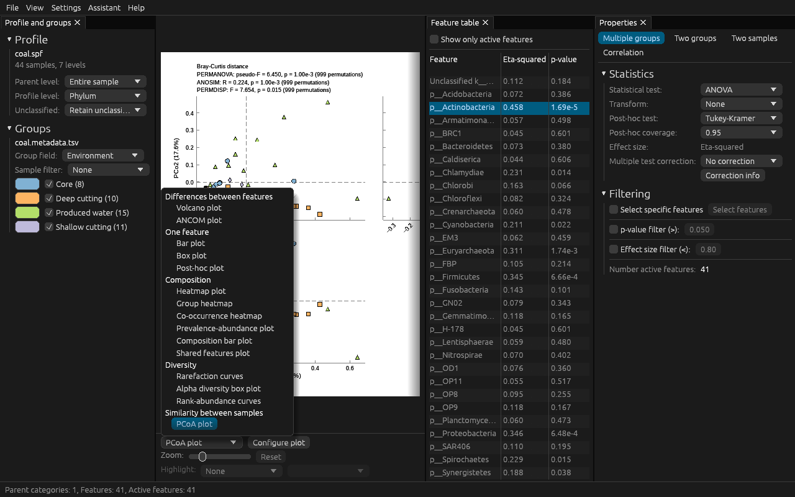
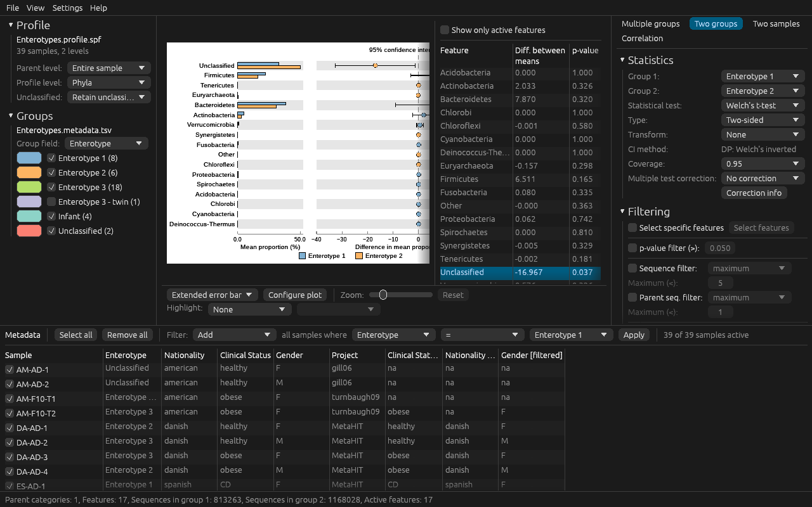

The main window
===============

.. figure:: images/gui_main_window.png
   :width: 100%

   The STAMP window: profile and groups, with statistics as the tab beside
   it (left), the plot (centre) and the feature table (right).

The plot is always in the middle. The other parts of the window are frames
that can be moved around it (see `Arranging the window`_); the sections
below describe them where STAMP first puts them.

Profile and groups (left)
-------------------------

*Profile and groups* and *Statistics* share the left of the window as tabs:
click a tab to bring it to the front.

* **Parent level**, **Profile level** and **Unclassified** choose what is
  analysed; see :doc:`input_files`.
* **Group field** chooses the metadata field whose values form the groups.
  Each group is listed with its number of samples switched on. Untick a
  group to switch all its samples off: they leave every analysis and plot
  (the two-sample and correlation analyses too) and are unticked in the
  metadata table, where they stay off, whatever the group field, until the
  group is ticked again or they are ticked there. A group is ticked while any
  of its samples is switched on. A group with a single sample is ticked, but
  the multiple-group tests cannot use it: they leave it out and say so in
  the Statistics panel. Click a group's colour to change it; the colour is
  used in every plot.
* **Sample filter** chooses the samples of every analysis by a metadata
  field: pick a field, then untick the values whose samples should be left
  out (each value is listed with its number of samples; *All* and *None*
  tick or untick them all). Samples left out take no part in any analysis
  or plot, including group statistics, distances and ordinations, and are
  not offered in the two-sample lists; groups left without samples
  disappear from the list of groups. The number of samples kept is shown
  beneath the values. Choose *None* as the field to keep every sample again.
  Loading other metadata or another profile clears the filter. The command
  line does the same with ``--where`` (see :ref:`cli-sample-filter`).

Plot (centre)
-------------

Beneath the plot are:

* the **plot selector**, listing the plots available for the current kind of
  analysis under six headings, by the question they answer (see
  :doc:`plots`);
* **Configure plot**, which opens the options of the current plot in a frame
  of their own (a third tab on the left to start with): its size, what it
  shows, its legend and the font sizes of its own text. Changes apply at
  once; **Restore defaults** returns this plot's options to STAMP's, and
  **Close** (or the × of its tab) closes the frame;
* **Zoom**, which enlarges the plot on screen without changing its size when
  saved;
* **Highlight**, which draws chosen features in red, in the plots that can:
  choose a level and a name, and every feature under that name is
  highlighted.

Point at any part of a plot to see what it stands for: a sample, a feature,
a group. Clicking a feature selects it.

   The plot selector, with the plots of a multiple-group analysis by group.

Feature table (right)
---------------------

The feature table lists every feature with its effect size and p-value.
Tick *Show only active features* to hide those removed by the filters.
Click a feature to show it in the plots of a single feature (bar, box and
post-hoc plots) and to highlight it in the prevalence-abundance plot. While
the box plot is shown, Ctrl+click (Cmd+click on a Mac) adds a feature to the
box plot's list of features, or removes it, and the plot then shows the list
(see :ref:`box plots of several features <plot-box-features>`).
Click a heading to sort by that column; click again to reverse the order.
Once a row has been clicked, the **Up** and **Down** arrow keys move to the
row above or below, until you click elsewhere; the results table works the
same way.

Statistics (left, a tab)
------------------------

The tabs at the top choose the kind of analysis: **Multiple groups**, **Two
groups**, **Two samples** or **Correlation** (see :doc:`analyses`). Below
them:

* **Statistics**: the samples or groups compared, the statistical test, the
  confidence interval method and coverage, and the multiple-test correction.
  *Correction info* summarises the correction (for example, the estimated
  proportion of true null hypotheses for Storey's FDR).
* **Filtering**: which features are *active*, by p-value, number of
  sequences and effect size, or chosen by hand with *Select specific
  features*.

Progress and cancelling
-----------------------

Work that can take more than a moment is done in the background, so the
window keeps answering while it runs. Its progress is shown in the status
bar at the bottom of the window, with a **Cancel** button:

* **Analyses.** While the test of every feature runs, the status bar shows
  *Running test...* with a progress bar. **Cancel** stops it and clears
  the earlier results, which were made with other settings; change a
  setting to run the test again.
* **Slow plots.** The PCoA (with its community tests), NMDS, distance
  box, Mantel and ANCOM plots compute distances, ordinations and
  permutation tests that take several seconds for hundreds of samples (NMDS
  of 1,300 samples takes about ten seconds on the desktop). If the plot is
  still being computed after a moment, the plot shown before is greyed out
  and a panel in the middle of the plot area says what is being done, with
  a progress bar where the work can be counted (for example *PERMANOVA
  412/999* or *NMDS iterations 120/500*; steps that cannot be counted, such
  as finding the principal coordinates, show a moving bar). **Cancel**
  stops the calculation; the plot area then offers **Compute again**.
  Everything else in the window can be used meanwhile, and once computed a
  plot is kept, so changing its colours, shapes or sizes redraws it at
  once.
* **Large profiles.** Reading a large profile, or many Sandpiper files
  together, shows *Reading ...* in the status bar and the plot area.
* **The results table** of a large analysis (a column for every sample of
  a thousand samples or more) is built a few rows at a time while
  **View > Results table** is open, which shows how far it has got; saving
  it before it is complete saves it once it is.

.. figure:: images/gui_plot_progress.png
   :width: 100%

   A PCoA of the large example dataset (600 samples) being computed: the
   plot before is greyed out, and the panel says which community test is
   running and how far it has got (permutations done of 999).

Tables
------

* **View > Results table** shows the full results along the bottom of the
  window: every feature with its hierarchy, statistics and the counts of
  every sample, as saved by **File > Save results table**. *Show only active
  features* hides those removed by the filters; **Download** saves the
  table.
* **View > Metadata table** shows the metadata along the bottom of the
  window. Untick a sample to leave it out of every analysis, or use the
  filter to tick or untick all samples matching a condition (for example,
  *Remove all samples where Nationality = american*). Samples left out by
  the *Sample filter* are greyed out here.
* **View > Assistant** (desktop application) shows or hides the assistant
  panel on the right of the window, with a tab for each assistant open
  (OpenCode, Claude Code, Google Antigravity); see :doc:`assistant`. **View
  > Assistant activity** lists every request an assistant has made of STAMP.

The tables along the bottom share the room as tabs: click a tab to bring
its table to the front.

   The metadata table along the bottom of the window.

.. _arranging-the-window:

Arranging the window
--------------------

Seven parts of the window are frames you can move: *Profile and groups*,
*Statistics*, the *Feature table*, the *Metadata table*, the *Results
table*, *Configure plot* and, in the desktop application, the *Assistant*.
Each has a tab with its name. STAMP starts with *Profile and groups* and
*Statistics* as tabs on the left, the *Feature table* on the right, and the
*Metadata table* and *Results table* as tabs along the bottom (shown when
you choose them in the View menu); the *Assistant* appears on the right
when you open an assistant.

* **Move a frame** by dragging its tab. While you drag, STAMP shows where
  the frame would go: drop it at the left, right, top or bottom edge of the
  plot or of another frame to put it beside that one, or on another frame's
  tabs to share its place as a tab.
* **Resize** frames by dragging the gap between them.
* **Close a frame** with the × on its tab; the View menu (or the button that
  opens it) brings it back in the same place. The room of a closed frame
  goes to the plot. Choosing a frame in the View menu while it is behind
  another tab brings it to the front.
* **Settings > Preferences > Restore window position defaults** puts every
  frame back where STAMP first put it, and floating windows (such as
  Preferences and Assistant activity) back where they first open.

STAMP remembers the arrangement from one run to the next.

.. figure:: images/gui_frames.png
   :width: 100%

   Configure plot open as a tab on the left, and the results table along
   the bottom.

Saving plots
------------

**File > Save plot as** saves the current plot:

* **PNG**, a picture, at a resolution you choose (300 dots per inch suits
  most journals);
* **SVG** or **PDF**, drawings whose text and shapes stay editable in
  programs such as Inkscape or Adobe Illustrator. The text of a PDF is real
  text in the plot's font, which is embedded, so it can be searched and
  copied.

**View > Send plot to window** opens the current plot in a window of its own,
so that several plots can be compared side by side. It is a window of
the system, which can be moved anywhere, outside STAMP's window or onto
another screen. Its **Save as PNG**, **Save as SVG** and **Save as PDF**
buttons save that plot as **File > Save plot as** saves the plot of the main
window (PNG asks for the resolution first).

Preferences
-----------

**Settings > Preferences** holds settings that apply everywhere:

* the **colour scheme** of the window: **Dark** (the default), **Light**,
  one of the four `Catppuccin <https://catppuccin.com>`_ schemes, **Latte**
  (light), **Frappé**, **Macchiato** and **Mocha** (dark), or `Solarized
  <https://ethanschoonover.com/solarized/>`_ **Light** or **Dark**. Plots
  keep their own colours, on a white page, whatever the scheme;
* the **random seed** and number of **replicates** of the resampling methods
  (bootstrap, permutation, White's test, Storey's FDR, the community tests).
  The same seed gives the same results every time;
* the **pseudocount** added where a ratio would otherwise be undefined
  (a feature absent from a sample);
* the **smallest p-value reported**: smaller ones are shown as a bound, such
  as "< 1e-15";
* the colours of the two samples, of "All other samples" and of axes;
* the **plot font** (Arial, Times New Roman, Courier New or DejaVu Sans) and
  the font sizes of axis labels, tick labels and legends.

**Restore defaults** returns these settings to STAMP's. **Restore window
position defaults** puts the frames and floating windows back where STAMP
first opens them (see `Arranging the window`_).

Settings are remembered between sessions.

Keyboard shortcuts
------------------

========================  =========================================
Ctrl+O (Cmd+O on macOS)   Load profile file
Ctrl+S                    Save the plot as a PNG image
Ctrl+T                    Show or hide the results table
Ctrl+M                    Show or hide the metadata table
Ctrl+L                    Show or hide the profile and groups frame
Ctrl+P                    Show or hide the statistics frame
Ctrl+W                    Send the plot to a window of its own
Ctrl+Q                    Exit
========================  =========================================
