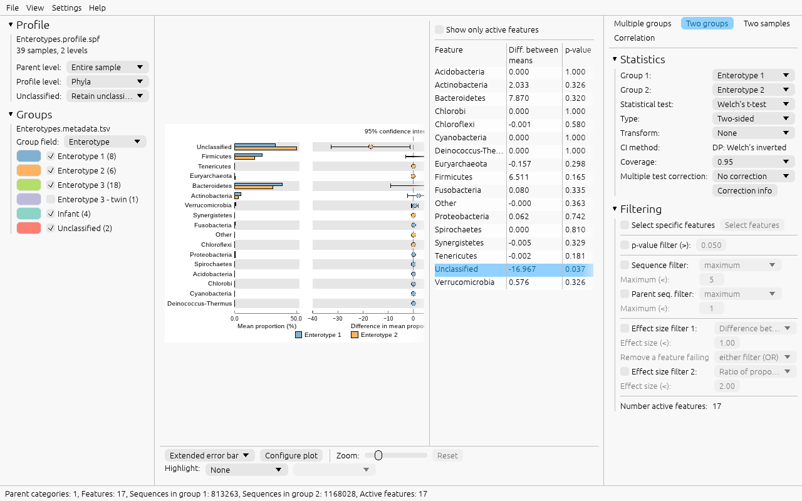

The main window
===============

   The STAMP window: profile and groups (left), plot and feature table
   (centre), properties (right).

Profile and groups (left)
-------------------------

* **Parent level**, **Profile level** and **Unclassified** choose what is
  analysed; see :doc:`input_files`.
* **Group field** chooses the metadata field whose values form the groups.
  Each group is listed with its number of samples. Untick a group to leave it
  out of every analysis; groups with a single sample start unticked, since
  they cannot be tested. Click a group's colour to change it; the colour is
  used in every plot.

Plot (centre)
-------------

Beneath the plot are:

* the **plot selector**, listing the plots available for the current kind of
  analysis under five headings, by the question they answer (see
  :doc:`plots`);
* **Configure plot**, which opens the options of the current plot: its size,
  what it shows, its legend and the font sizes of its own text;
* **Zoom**, which enlarges the plot on screen without changing its size when
  saved;
* **Highlight**, which draws chosen features in red, in the plots that can:
  choose a level and a name, and every feature under that name is
  highlighted.

Point at any part of a plot to see what it stands for: a sample, a feature,
a group. Clicking a feature selects it.

.. figure:: images/gui_plot_selector.png
   :width: 70%

   The plot selector, with the plots of a multiple-group analysis by group.

Feature table (centre right)
----------------------------

The feature table lists every feature with its effect size and p-value.
Tick *Show only active features* to hide those removed by the filters.
Click a feature to show it in the plots of a single feature (bar, box and
post-hoc plots). Click a heading to sort by that column; click again to
reverse the order.

Properties (right)
------------------

The tabs at the top choose the kind of analysis: **Multiple groups**, **Two
groups**, **Two samples** or **Correlation** (see :doc:`analyses`). Below
them:

* **Statistics**: the samples or groups compared, the statistical test, the
  confidence interval method and coverage, and the multiple-test correction.
  *Correction info* summarises the correction (for example, the estimated
  proportion of true null hypotheses for Storey's FDR).
* **Filtering**: which features are *active*, by p-value, number of
  sequences and effect size, or chosen by hand with *Select specific
  features*.

Tables
------

* **View > Results table** shows the full results: every feature with its
  hierarchy, statistics and the counts of every sample, as saved by **File >
  Save results table**. *Show only active features* hides those removed by
  the filters.
* **View > Metadata table** shows the metadata along the bottom of the
  window. Untick a sample to leave it out of every analysis, or use the
  filter to tick or untick all samples matching a condition (for example,
  *Remove all samples where Nationality = american*).

.. figure:: images/gui_metadata_table.png
   :width: 100%

   The metadata table along the bottom of the window.

Saving plots
------------

**File > Save plot as** saves the current plot:

* **PNG**, a picture, at a resolution you choose (300 dots per inch suits
  most journals);
* **SVG** or **PDF**, drawings whose text and shapes stay editable in
  programs such as Inkscape or Adobe Illustrator.

**View > Send plot to window** opens the current plot in a window of its own,
so that several plots can be compared side by side.

Preferences
-----------

**Settings > Preferences** holds settings that apply everywhere:

* the **random seed** and number of **replicates** of the resampling methods
  (bootstrap, permutation, White's test, Storey's FDR, the community tests).
  The same seed gives the same results every time;
* the **pseudocount** added where a ratio would otherwise be undefined
  (a feature absent from a sample);
* the **smallest p-value reported**: smaller ones are shown as a bound, such
  as "< 1e-15";
* the colours of the two samples, of "All other samples" and of axes;
* the **plot font** (Arial, Times New Roman, Courier New or DejaVu Sans) and
  the font sizes of axis labels, tick labels and legends.

Settings are remembered between sessions.

Keyboard shortcuts
------------------

========================  =========================================
Ctrl+O (Cmd+O on macOS)   Load profile
Ctrl+S                    Save the plot as a PNG image
Ctrl+T                    Show or hide the results table
Ctrl+M                    Show or hide the metadata table
Ctrl+L                    Show or hide the profile and groups panel
Ctrl+P                    Show or hide the properties panel
Ctrl+W                    Send the plot to a window of its own
Ctrl+Q                    Exit
========================  =========================================
