Plots explained
===============

The plot selector beneath the plot lists the plots available for the
current analysis under six headings, by the question they answer:

* `Differences between features`_: which features differ, and by how much?
* `One feature`_: what does the selected feature look like in every sample?
* `Composition`_: what are the samples made of?
* `Diversity`_: how rich and even are the samples?
* `Similarity between samples`_: how alike are the samples, and does that
  follow the groups or a measured number?
* `Where the samples are from`_: a map of the samples' locations.

Every plot can be changed with **Configure plot** and saved with **File >
Save plot as**. Point at any part of a plot to see what it stands for.

Groups are coloured in order from a palette of twenty colours: the ten of
STAMP v2 and then ten stronger ones, so that up to twenty groups can be told
apart (STAMP v2 drew every group after the tenth black). Beyond twenty the
colours repeat; plots with markers then also tell groups apart by shape, and
the command line warns. Any group's colour can be changed by clicking its
swatch in the groups section of the window.

.. note::

   The figures on this page were made from the example data: the iron mine
   samples of Edwards et al. (two samples, *Red* and *Black*), the
   enterotypes (two and multiple groups) and the coal seam gas samples
   (communities).

Differences between features
----------------------------

.. _plot-extended-error-bar:

Extended error bar
^^^^^^^^^^^^^^^^^^

*Two samples, two groups.* The main result plot of STAMP, and the first
shown for these analyses.

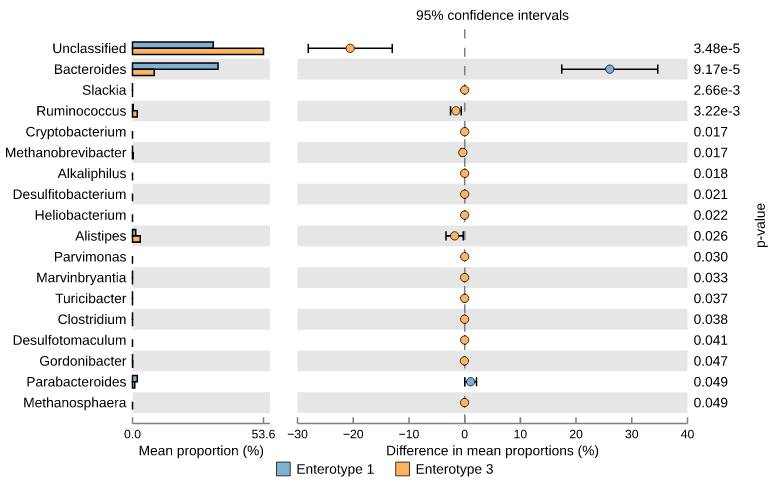

   Genera that differ between Enterotype 1 and Enterotype 3 (p < 0.05).

Each row is a feature that passed the filters.

* **Left**: the proportion of the feature in each sample, or its mean
  proportion in each group.
* **Middle**: the difference between them (the effect size), with its
  confidence interval. The marker takes the colour of the sample or group
  in which the feature is more abundant. The dashed line marks zero: no
  difference.
* **Right**: the p-value (or q-value, under an FDR correction).

**What to look for.**

* Rows whose interval is far from zero and narrow: large, well-supported
  differences. Here *Bacteroides* (about 26 points higher in Enterotype 1)
  and the unclassified sequences (about 20 points higher in Enterotype 3).
* Rows whose marker sits on zero with a tiny interval, such as *Slackia*
  here: significant, but too small to matter. An effect size filter removes
  them.
* Long intervals: differences whose size is uncertain.

Rows can be sorted by p-value, effect size or name in *Configure plot*.

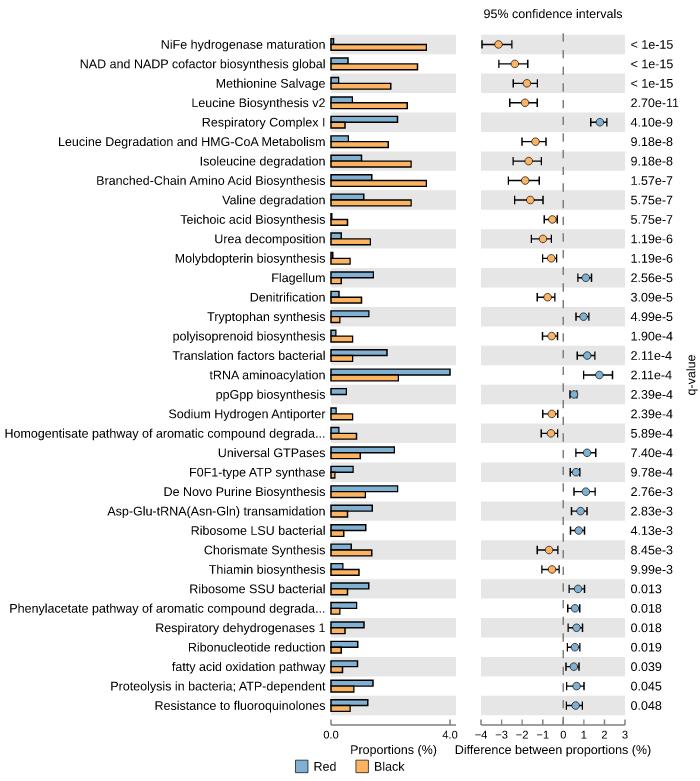

   Subsystems that differ between the *Red* and *Black* iron mine samples,
   with Benjamini-Hochberg q-values.

Volcano plot
^^^^^^^^^^^^

*All analyses.* Every feature as a point: the effect size along the bottom,
and the significance (−log\ :sub:`10` of the p-value) up the side, so that
the more significant a feature, the higher it sits. The horizontal dashed
line marks the significance threshold.

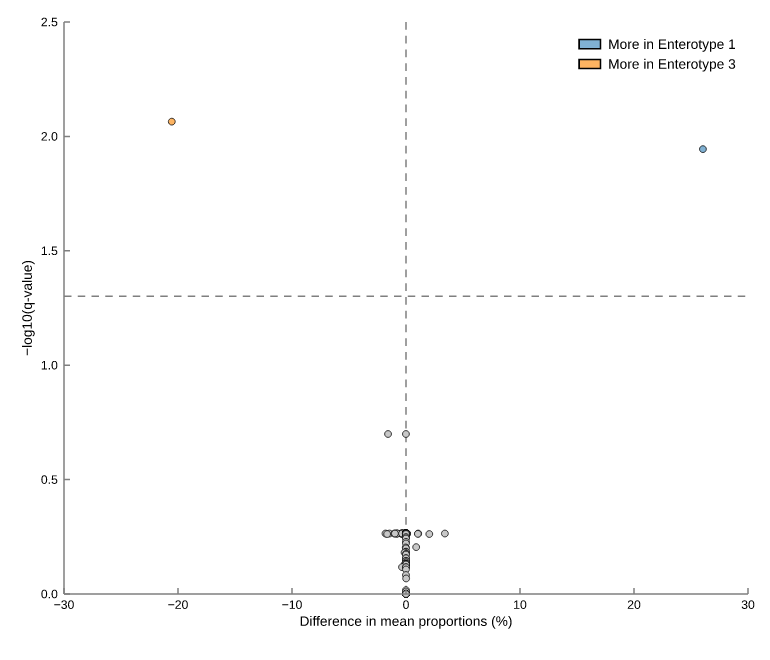

   Volcano plot of the genera of Enterotype 1 against Enterotype 3, with
   Benjamini-Hochberg q-values.

**What to look for.** The interesting features are in the **upper
corners**: large and significant. Points high up but near the middle are
significant but small; points far out to the side but low down are large
but uncertain (often rare, variable features). Here only two genera clear
the line after correction, one in each direction, and both have large
effects.

ANCOM plot
^^^^^^^^^^

*Two groups, multiple groups.* Each feature's W (how many of its log ratios
with other features differ between groups) against its effect size on the
CLR scale. Features called different are coloured and sit above the dashed
cut-off. See :ref:`the statistics page <ancom>` for how to read
it, with an example.

.. _plot-p-value-histogram:

p-value histogram
^^^^^^^^^^^^^^^^^

*Two samples, correlation.* The number of features with p-values in each
range, with an enlarged view of the p-values below 0.05.

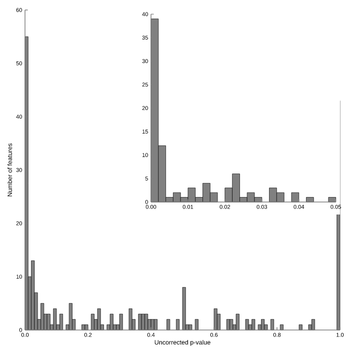

   Uncorrected p-values of the iron mine subsystems.

**What to look for.** If no feature truly differed, p-values would be spread
evenly from 0 to 1, giving a flat histogram. A **peak at the left** means
that some features truly differ; the higher the peak above the flat part,
the more of them. Here the peak is large, so many subsystems differ between
the two samples. A spike at exactly 1 is common with exact tests: rare
features with similar counts in both samples get a p-value of 1.

.. tip::

   A flat histogram with a few small p-values suggests that those p-values
   are mostly chance findings, however small they look. Choose whether to
   show corrected or uncorrected p-values in *Configure plot*; the
   uncorrected ones show this pattern best.

Multiple comparison plots
^^^^^^^^^^^^^^^^^^^^^^^^^

*Two samples.* Three views of the chosen multiple test correction: a
histogram of corrected p-values; corrected against uncorrected p-values;
and the number of features that would be significant at each threshold.

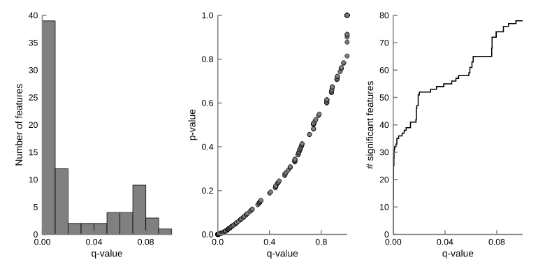

   The Benjamini-Hochberg correction of the iron mine subsystems.

**What to look for.** The right-hand panel helps choose a threshold: here
about 50 features are significant at a q-value of 0.02, and few more are
added until about 0.06. The middle panel shows how much the correction
raised the p-values.

One feature
-----------

These plots show the feature selected in the feature table. Click another
feature to change it. The box plot can also show several features at once.

Bar plot
^^^^^^^^

*Two groups, multiple groups:* the feature's proportion in **every
sample**, coloured by group, with a line at each group's mean.

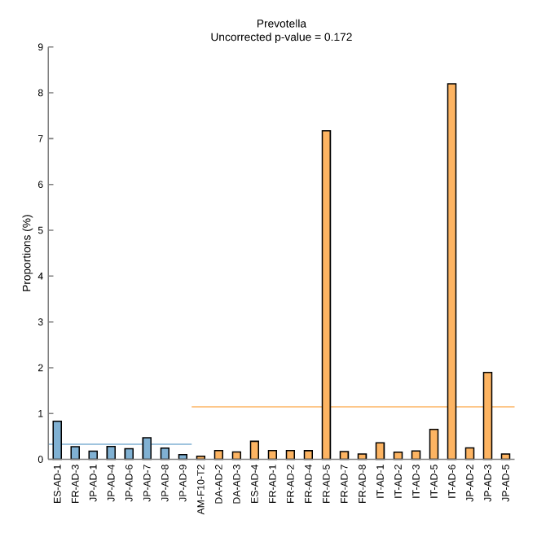

   *Prevotella* in every sample of Enterotypes 1 and 3.

**What to look for.** Whether a difference is shared by most samples of a
group or carried by a few. Here the mean of Enterotype 3 is pulled up by two
samples with 7 to 8% *Prevotella*; in the others it is as rare as in
Enterotype 1. This is why the difference is not significant (p = 0.17).

*Logarithmic axis* in *Configure plot* (``--bar-log``) draws the bars on a
log10 axis, as for the box plot below: a sample without the feature has no
bar, and the axis is labelled 0 below a break.

*Two samples:* a bar for each feature of a chosen statistic: sequences,
parent sequences, proportions, p-values (corrected or not) or effect
sizes.

.. figure:: images/ts_bar.png
   :width: 60%

   The proportion of each significant subsystem in the two iron mine
   samples.

Box plot
^^^^^^^^

*Two groups, multiple groups.* The distribution of the feature's
proportion in each group.

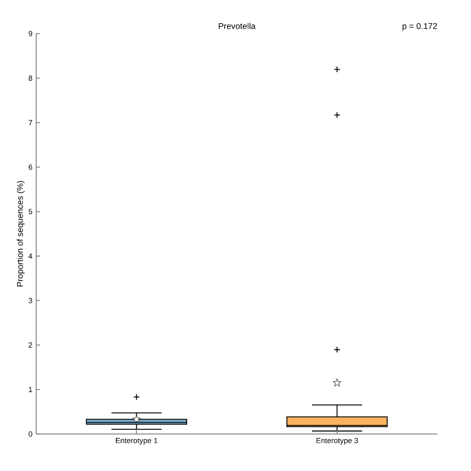

   *Prevotella* in Enterotypes 1 and 3.

How to read a box plot:

* the **box** spans the middle half of the samples (the 25th to 75th
  percentiles), and the **line** inside it is the median;
* the **whiskers** reach the most extreme samples within 1.5 box-lengths of
  the box;
* **crosses** are samples beyond the whiskers;
* the **star** is the mean.

**What to look for.** Overlap of the boxes; a mean (star) far from the
median, a sign that a few extreme samples dominate, as in Enterotype 3
here; and groups of very different spread, a reason to prefer Welch's test
or Games-Howell.

.. _plot-box-features:

**Several features, and a logarithmic axis.** *Configure plot* chooses which
features to show: the selected one, the most significant that pass the
filters (any number), or a list typed one per line. While the box plot is
shown, **Ctrl+click** (Cmd+click on a Mac) in the feature table adds a
feature to the list or removes it, and switches the plot to the list. Several features are drawn either

* **side by side**, a box per group at each feature, coloured by group with
  a legend, or
* **one panel per feature** (small multiples), the groups along the axis of
  each, with the same value axis in every panel or each its own.

Other options: horizontal boxes; every sample drawn as a small,
semi-transparent point spread across its box (very useful when a group of
two samples stands beside one of a thousand; the points replace the crosses
for samples beyond the whiskers); the number of samples after each group's
name; and the order of the groups: as in the analysis, alphabetical,
highest median (of the first feature) first, or by a coarser metadata field
(each group taking the value most common among its samples, host order for
host groups, say), with dashed lines between its categories.

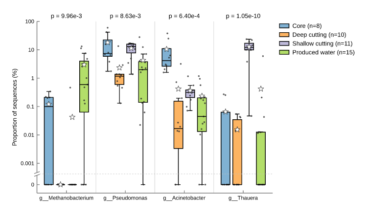

   Four genera in the four coal seam gas sample types on a logarithmic
   axis, with every sample as a point, the groups ordered by *Core vs.
   Water*.

The **logarithmic axis** (log10, labelled 0.001, 0.01, 0.1, 1, 10 %) shows
features whose proportions span several orders of magnitude, where a linear
axis squeezes most groups against zero. Zeros have no logarithm: they are
drawn on a line labelled **0** below a break in the axis (two slanted
strokes and a dashed line across the plot), so samples without the feature
stay visible and counted. The box itself does not depend on the axis: the
quartiles, the median and the whiskers (the most extreme samples within 1.5
interquartile ranges of the box, Tukey's rule) are computed on the
proportions themselves, zeros included, and then placed on the log axis. A
lower whisker that reaches the 0 line therefore means that the lower fence
of the linear rule falls below zero, as it does for a skewed group; on a log
axis the whiskers can look asymmetric for the same reason. A quartile
between a zero and a small value can lie below the smallest proportion seen.
The mean (star) of a group made mostly of zeros can be orders of magnitude
below every sample; when it falls below the lowest power of ten on the axis
it is not drawn, and its tooltip still gives it.

**What to look for**, on top of the above. Features confined to some
groups: in the figure *Methanobacterium* is in 11 of the 15 produced water
samples (median about 0.6%), but on the 0 line for every deep cutting and all but
one shallow cutting, while *Thauera* is abundant (about 10%) in every
shallow cutting and rare or absent elsewhere. The points show how many
samples carry a feature at all and whether a group's box rests on a few
samples; a box of a group of two or three samples is little more than its
points.

Post-hoc plot
^^^^^^^^^^^^^

*Multiple groups.* Every pair of groups compared for the selected feature,
as an extended error bar plot: mean proportions on the left, the difference
with its confidence interval in the middle, the p-value on the right. See
:ref:`post-hoc-tests` for an example.

As in STAMP 2, the plot starts by showing only the pairs of groups that
differ significantly; untick *Filter rows above nominal level* in
*Configure plot* to see every pair.

Correlation scatter plot
^^^^^^^^^^^^^^^^^^^^^^^^

*Correlation.* One point per sample: the number from the metadata along the
bottom, the feature's proportion up the side, with the least-squares line
and the correlation, its p-value and the number of samples. Points are
coloured by the groups of the group field.

**What to look for.** Whether the trend is carried by all samples or by one
or two at the end of the range; whether the relationship is a line or a
curve (use Spearman's correlation for curves); and whether the groups
form separate clouds, which can create a correlation across groups that
does not exist within any of them.

Composition
-----------

Composition bar plot
^^^^^^^^^^^^^^^^^^^^

*All except correlation.* Each sample (or each group's mean) as a stacked
bar of its most abundant features; the rest are added up as *Other*.

.. figure:: images/mg_composition.png
   :width: 100%

   Genus composition of the enterotype samples. The coloured strip beneath
   the bars shows each sample's group.

**What to look for.** Features that dominate some groups: here *Prevotella*
(red) is abundant in most samples of Enterotype 2 (orange strip) and rare
elsewhere, and *Bacteroides* (the orange segments) makes up more of the
Enterotype 1 samples. The number
of features shown is set in *Configure plot*.

Profile bar plot
^^^^^^^^^^^^^^^^

*Two samples.* The proportion of the most abundant features in both
samples, side by side, with 95% confidence intervals; a star marks
features that differ significantly.

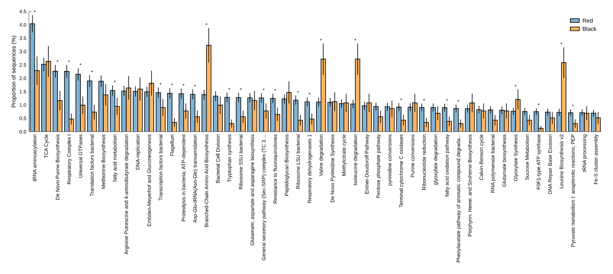

   The most abundant subsystems of the two iron mine samples.

Heatmap plot
^^^^^^^^^^^^

*Two groups, multiple groups.* Proportions of features (rows) in samples
(columns), as colours. Samples and features are clustered so that similar
ones sit together, with the tree of the clustering (dendrogram) along the
edges. The coloured strip above the samples shows their groups.

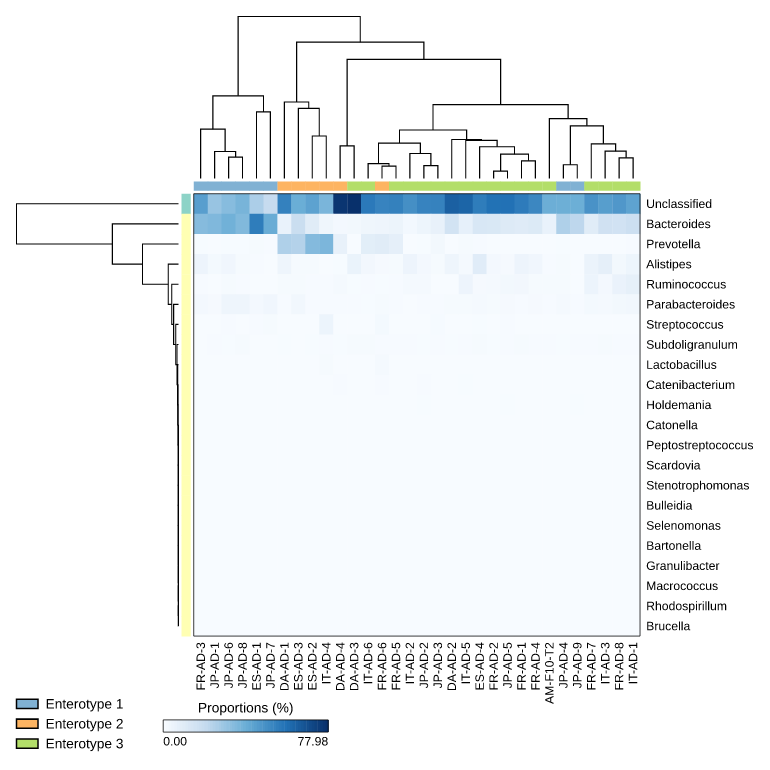

   Genera of the enterotype samples, clustered by average linkage.

**What to look for.** Whether samples of a group cluster together (here the
most of the Enterotype 2 samples, rich in *Prevotella*, form one
branch), and blocks of
colour marking features typical of a group. By default all features are
shown; *Configure plot* can limit it to the active features, change the
clustering method and the colours.
It draws at most 1000 samples and 1000 features; for more samples, the
`Group heatmap`_ summarises each group in one column.

.. _plot-group-heatmap:

Group heatmap
^^^^^^^^^^^^^

*Two groups, multiple groups.* One column per **group** instead of per
sample, so it stays readable however many samples there are (the heatmap of
samples stops at 1000). Each cell summarises the feature in the group's
samples, chosen in *Configure plot*:

* **Mean**, **median** or **maximum** proportion (%), or
* **Prevalence**: the percentage of the group's samples in which the feature
  is present (above zero, or at least a minimum proportion that you set).

Only the samples of the analysis count: samples switched off, left out by
the sample filter or outside the chosen groups are in neither the values
nor the number of samples shown after each group's name. With a parent
level, proportions are taken within the parent (species within their
genus, say); a sample without the parent counts as 0 for its children, so
the mean and median are over all the group's samples and prevalence is the
share of all its samples, not only of those that have the parent. Cells that are exactly zero are grey, apart from the colour
scale; on a logarithmic scale, values below the smallest value shown take
its colour. The rows are the features of highest mean abundance (50 by
default; *Plot only active features* restricts them to those that pass the
filters). Rows and columns can be clustered, or the groups ordered and
labelled by a coarser metadata field (*Label groups by field*), and the
values can be written in the cells.

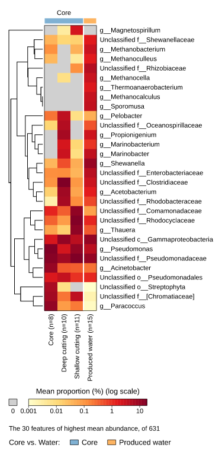

   Mean proportions of the 30 most abundant genera in the four coal seam
   gas sample types, on a logarithmic scale, the groups ordered by *Core vs.
   Water*.

**What to look for.** Features confined to some groups: here the
methanogens (*Methanobacterium*, *Methanoculleus*, *Methanocalculus*) are
abundant in produced water and absent (grey) from some or all of the three
kinds of core sample, while *Pseudomonas* and *Acinetobacter* are most
abundant in the cores and cuttings. The mean
is pulled up by a few samples with a bloom; compare it with the
**median** (the typical sample) and **prevalence** (how many samples have
the feature at all): a high mean with a low prevalence marks a feature that
is abundant in a few samples only. The same summaries, cell by cell, can be
written to a table from the command line (``--heatmap-table``).

.. _plot-prevalence-abundance:

Prevalence-abundance plot
^^^^^^^^^^^^^^^^^^^^^^^^^

*Two groups, multiple groups.* One point per feature: across, its **mean
relative abundance** on a logarithmic axis; up, its **prevalence**, the
percentage of samples in which it is present (above zero, or at least the
minimum proportion set in *Configure plot*). This is an occupancy-abundance
plot. The mean is over all of a group's samples, counting a sample without
the feature as zero, or (*Mean abundance over*) only over the samples where
it is present. Features absent from a group are not drawn for it. Only the
samples of the analysis count, as for the group heatmap, and the features
are those of the profile level, with unclassified sequences treated as
chosen; *Plot only active features* restricts them to those that pass the
filters.

Three views:

* **One panel per group** (the default), on the same axes, so that a feature
  can be followed from group to group;
* **All groups in one panel**, coloured by group, or one chosen group;
* **Specificity**: each feature once, at the group where it is most
  prevalent. Its *specificity* is its prevalence there minus its highest
  prevalence in any other group, in percentage points: 0 for a feature found
  as often elsewhere, 100 for one in every sample of one group and none of
  any other. Features at or above a threshold (50 by default) take the
  colour of their group; the rest, shared between groups, are grey.

The selected feature, features typed in *Configure plot* and those of the
highlight control are drawn in red and named; pointing at any point gives
its numbers.

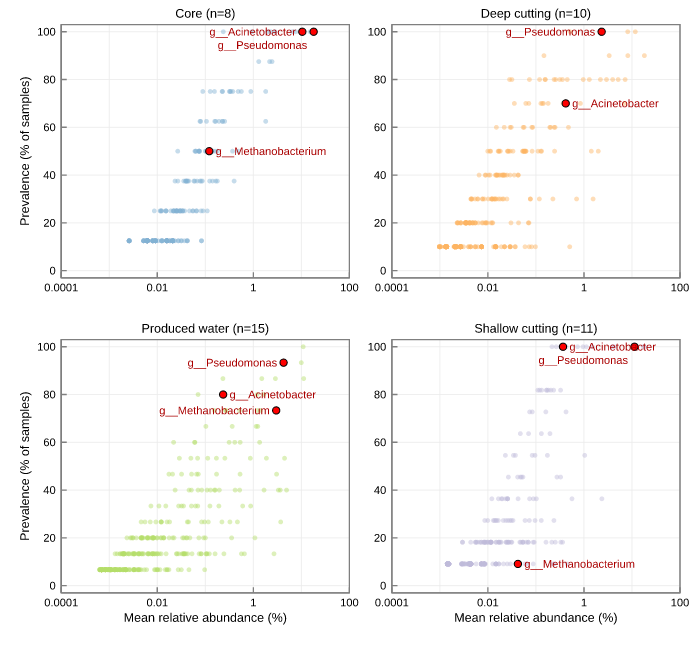

   Genera of the coal seam gas samples, one panel per sample type, with
   three genera highlighted.

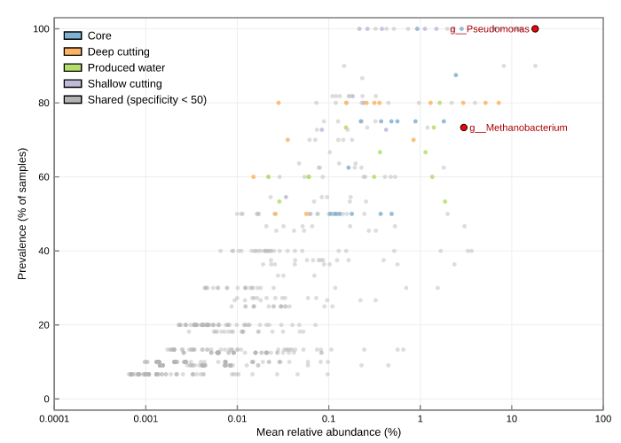

   The same genera in the specificity view.

**What to look for.** The upper right holds the core community of a
group: features in most of its samples and abundant. A feature high in one
panel and low or missing in the others is a specialist of that group; one
in the upper right of every panel is shared by all. Here *Pseudomonas* is
in every core and cutting and nearly every produced water sample, while
*Methanobacterium* is in 73% of the produced water samples, half of the
cores, one shallow cutting and no deep cutting. Prevalence and abundance usually rise together; a feature far to the
right of the cloud at a given prevalence is abundant where present (a
bloom), and one far to the left is widespread but rare. Beware small groups:
in a group of two samples every feature has a prevalence of 0, 50 or 100%,
so many features look like perfect specialists of it in the specificity
view by chance. ``--prevalence-table`` on the command line writes the
numbers behind the plot.

.. _plot-co-occurrence:

Co-occurrence heatmap
^^^^^^^^^^^^^^^^^^^^^

*Two groups, multiple groups, correlation.* The correlation of every pair of
the chosen features across the samples of the analysis (or of one of its
groups): which features rise and fall together. Red cells are positive
correlations, blue negative; features are clustered so that those that
co-vary sit together, in the same order along both axes. An asterisk marks
correlations whose Benjamini-Hochberg q-value (over all the pairs shown) is
below 0.05, optionally only those at least a chosen distance from zero.

The features are the 30 of highest mean abundance (or prevalence), plus any
you name; features present in too few samples can be left out first.
Correlations are Spearman's (default) or Pearson's, of proportions or of
**centred log ratios** (CLR, recommended; see the caveat below).

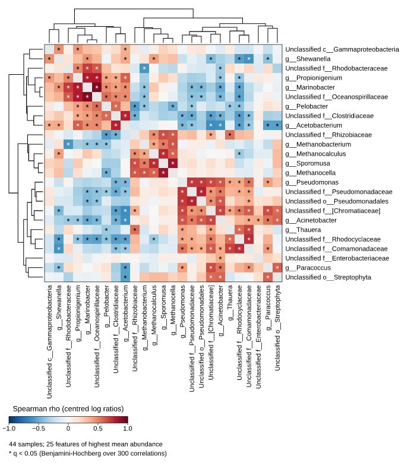

   Spearman correlations of the centred log ratios of the 25 most abundant
   genera in the 44 coal seam gas samples.

**What to look for.** Red blocks along the diagonal are groups of features
that occur together: here the methanogens of the produced water
(*Methanobacterium*, *Methanocalculus*, *Methanocella*) with *Sporomusa*;
*Pseudomonas*, *Acinetobacter* and *Thauera* with their relatives; and
*Marinobacter* with the Oceanospirillaceae and *Propionigenium*. Blue
between two blocks (here between the last two) means the groups replace
each other, often because they belong to different kinds of sample: a
co-occurrence across a mixture of
environments mostly reflects the environments. Correlate within one group
(*Samples* in *Configure plot*, ``--group`` on the command line) to see
associations within an environment.

With *Show: The selected feature against all others*, the plot shows the
strongest correlations of the feature selected in the feature table with
every other feature, as bars:

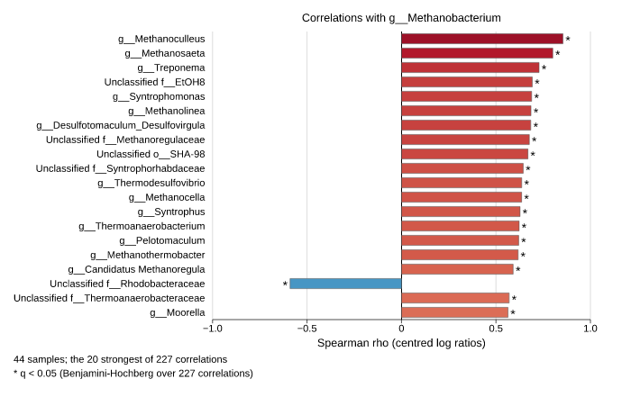

   The 20 genera most strongly correlated with *Methanobacterium* (CLR,
   genera present in at least 10% of the samples).

.. warning::

   **Correlations of proportions are biased.** Proportions add up to 100%,
   so when one feature rises the others must fall: two features that do not
   interact at all can appear negatively correlated, and with few dominant
   features the bias is strong. Correlate **centred log ratios** to remove
   the constraint, prefer features present in most samples (many zeros
   make any correlation unreliable), and treat a correlation as a
   hypothesis, not as an interaction: two features can co-vary because they
   both respond to something else. With many samples even weak
   correlations are significant; set a minimum correlation for the marks.
   See :ref:`co-occurrence` in the statistics guide.

Scatter plot
^^^^^^^^^^^^

*Two samples, two groups.* Each feature as a point: its proportion in the
first sample or group along the bottom, in the second up the side. Features
on the dashed diagonal are equally abundant in both; points are coloured by
the sample or group in which they are more abundant. Bars show 95%
confidence intervals for two samples, and the spread within each group for
two groups (standard deviation, percentiles and others, chosen in
*Configure plot*). Histograms along the edges show how the proportions are
distributed.

.. figure:: images/ts_scatter.png
   :width: 70%

   Subsystems of the two iron mine samples.

**What to look for.** Points far from the diagonal. R² measures how well
the diagonal describes the points: near 1 means the two profiles are much
alike.

.. figure:: images/tg_scatter.png
   :width: 70%

   Genera of Enterotypes 1 and 3, with the standard deviation of each
   group.

Shared features plot
^^^^^^^^^^^^^^^^^^^^

*All except correlation.* Which features each group has, and which they have
in common. A feature counts as present in a group if it is found in at least
a chosen share of the group's samples (50% by default).

The **UpSet plot** works for any number of groups. Each column is one
combination of groups, marked by the dots beneath it; its bar is the number
of features found in exactly that combination.

.. figure:: images/mg_shared_upset.png
   :width: 90%

   Genera of the four coal seam gas sample types. The number beside each
   group is how many genera it has.

**Example.** 21 genera are found only in deep cuttings and 19 only in core;
5 are shared by core and deep cuttings only; just one is found in all four
sample types (the last column).

For two or three groups, a **Venn diagram** can be drawn instead.

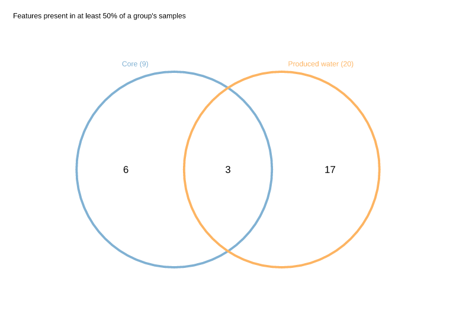

   Genera of core and produced water samples.

Sequence histogram
^^^^^^^^^^^^^^^^^^

*Two samples.* How many features have each number of sequences, in each
sample.

.. figure:: images/ts_sequence_histogram.png
   :width: 60%

**What to look for.** If most features have only a few sequences, as in the
*Black* sample here, many will be too rare to test reliably; consider the
sequence filter, or a test suited to small counts such as Fisher's.

Diversity
---------

.. _plot-rarefaction:

Rarefaction curves
^^^^^^^^^^^^^^^^^^

*All except correlation; needs counts.* The number of features expected if
fewer sequences had been read. Each curve rises steeply at first, as common
features are found, and flattens as only rare ones remain to be found.

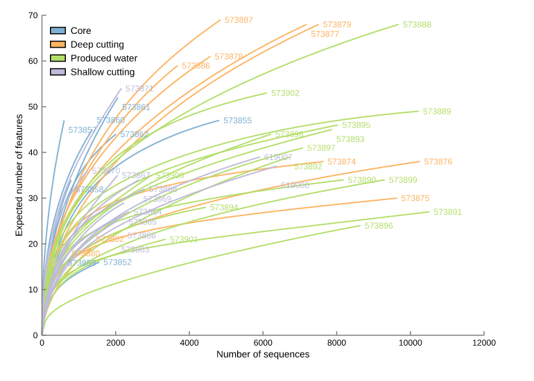

   Rarefaction curve of every coal seam gas sample.

**What to look for.** A curve that has **levelled off** belongs to a sample
sequenced deeply enough to find most of its features. A curve still rising
steeply means more sequencing would find more features, and its count of
features is an underestimate. Compare samples at the same number of
sequences (a vertical line), not at their ends: samples that were sequenced
more deeply always end higher.

*Configure plot* draws a curve for each sample, for each group's pooled
sequences, or for each group **by number of samples**: how many features
would be found with fewer samples.

.. figure:: images/mg_rarefaction_accumulated.png
   :width: 80%

   Features found against number of samples, for each sample type.

Here no curve has levelled off: more samples of any type would find more
features.

Rank-abundance curves
^^^^^^^^^^^^^^^^^^^^^

*All except correlation.* Each sample's (or group's) features ordered from
the most abundant to the least, against their proportion on a logarithmic
scale.

.. figure:: images/mg_rank_abundance.png
   :width: 80%

   Rank-abundance curves of the phyla in each coal seam gas sample type.

**What to look for.** A **steep** curve is a community dominated by a few
features; a **flat**, long curve is an even community with many features.
Here produced water has the longest, flattest tail: more phyla, more
evenly represented.

Alpha diversity box plot
^^^^^^^^^^^^^^^^^^^^^^^^

*Two groups, multiple groups.* The diversity of each sample, by group, as
box plots, with a Kruskal-Wallis test of whether the groups differ. The
measure (observed features, Shannon, Simpson, Chao1) is chosen in
*Configure plot*; see :doc:`statistics` for what each means.

.. figure:: images/mg_alpha_diversity.png
   :width: 80%

   Shannon diversity of the coal seam gas samples.

**Example.** The medians differ a little, but the boxes overlap broadly and
the Kruskal-Wallis p-value is 0.45: no evidence that the sample types differ
in diversity. They may still differ in *which* organisms they contain (see
the PCoA plot of the same samples in :doc:`statistics`).

Similarity between samples
--------------------------

These plots place samples so that similar samples are close together.
*Ordination* is the general name for this: a map of many dimensions (one
per feature) squeezed into two that keep as much of the picture as
possible.

PCA plot
^^^^^^^^

*Two groups, multiple groups.* Principal component analysis of the
proportions of all features. The first principal component (PC1) is the
direction in which the samples vary most; PC2 the next, at right angles to
it; and so on. Three panels show PC1 against PC2, PC3 against PC2 and PC1
against PC3. Each axis gives the share of all variation it captures.

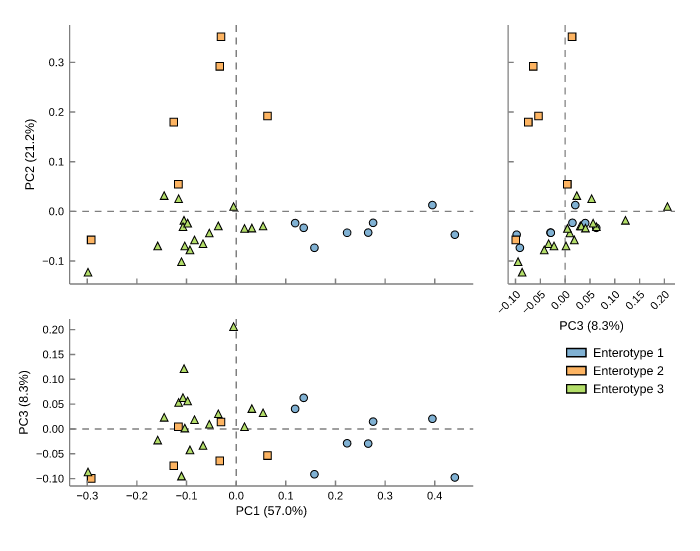

   PCA of the genera of the three enterotypes.

**What to look for.** Whether groups form separate clouds. Here
Enterotype 1 is separated from the others along PC1, which captures 57% of
the variation, and Enterotype 2 along PC2. If the first two axes together
capture little of the variation, the plot shows only a small part of the
picture.

.. tip::

   PCA of proportions is dominated by the most abundant features. To see
   whether the groups differ in the rest of the community too, use the PCoA
   plot with the Jaccard distance.

PCoA plot
^^^^^^^^^

*Two groups, multiple groups.* Principal coordinates analysis: like PCA,
but built from a chosen distance between samples (Bray-Curtis, Jaccard or
Aitchison), which suits community data better. Above the plot are the
results of PERMANOVA, ANOSIM and PERMDISP, whether the groups differ as a
whole. See :ref:`the community tests <community-tests>` for an
example of how to read them.

NMDS plot
^^^^^^^^^

*Two groups, multiple groups.* Non-metric multidimensional scaling: places
the samples in two dimensions so that the *order* of the distances between
them is kept as well as possible. It makes no assumption about the shape of
the data, and often separates groups more clearly than PCoA. The axes have
no units, and only the relative positions of samples mean anything.

.. figure:: images/mg_nmds.png
   :width: 80%

   NMDS of the coal seam gas samples (Bray-Curtis distance).

**What to look for.** First the **stress** above the plot (here 0.16,
fair): see :ref:`nmds-stress`. Then the groups: here the shallow
cuttings form a tight cluster, core samples sit beside them, and deep
cuttings and produced water spread widely.

.. _ordination-colours:

Colouring and shaping the samples
^^^^^^^^^^^^^^^^^^^^^^^^^^^^^^^^^

The PCA, PCoA and NMDS plots colour samples by group unless asked
otherwise. **Colours and shapes** in Configure plot (``--color-by`` and
``--shape-by`` on the command line) offers instead:

* **another metadata field**, for example the host order when the groups
  are host species. A field whose values are text gets a colour for each
  value (from the same twenty-colour palette, repeating beyond twenty, with
  a note). Fields holding numbers are marked *(numeric)* in the list;
* **a numeric field**, for example latitude or sequencing depth, drawn on a
  continuous colour scale (viridis by default; plasma, magma, cividis and
  the heatmap colour maps are offered too) with a colour bar beside the
  plot. A field counts as numeric when at least three of its values are
  numbers and numbers make up at least 90% of the values given; tick
  *Treat the numbers as categories* to give each number its own colour
  instead (a year, say). A **logarithmic** scale suits skewed values such
  as abundances; zeros are then drawn at half the smallest positive value,
  at the foot of the bar labelled 0, and the legend says how many;
* **the abundance of a feature**: its percentage of each sample at the
  profile level, as the bar and box plots show it. Choose *Selected feature*
  to follow the selection in the feature table, or *Feature by name*.

Samples with no value (an empty cell, ``NA``, ``N/A``, ``NaN``, ``null`` or
``None``; for a numeric field also the odd word among numbers) are drawn as
small grey hollow markers, and counted in the legend as *No value*.

**Shape by** gives each value of a second categorical field its own marker:
circle, square, triangle, diamond, hexagon, inverted triangle, star, cross,
plus and pentagon. A field with more than ten values keeps its own shapes for
its nine commonest values and draws the rest with one shape, listed as
*Other* with a note. Without a shape field, samples coloured by anything but
their group keep a shape per group (if *Assign unique shapes* is ticked), so
both can be read from the plot.

When the samples are coloured or shaped by anything but the groups, the
legend is drawn beside the plot, on the right, with a section for colours and
one for shapes; each lists the number of samples with each value. Pointing at
a sample shows its name, its group and its values of both fields.

**Drawing order** decides which samples lie on top when they overlap: by
default the highest values are drawn last, so that a few samples with a high
value are not hidden under hundreds with a low one. *Marker size* and
*Opacity* (from 0.05 to 1) under Other options also help with many samples.

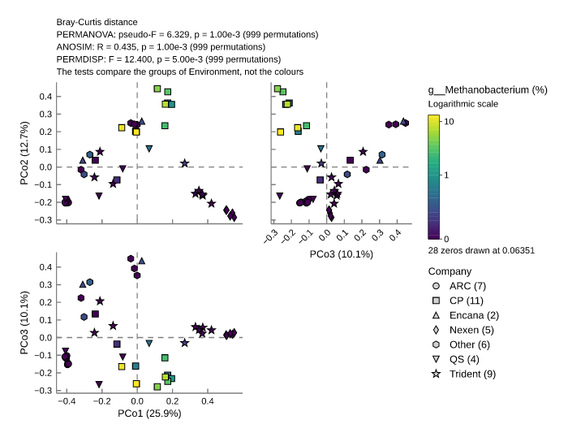

   PCoA of the coal seam gas samples (Bray-Curtis distance, groups by
   environment) coloured by the abundance of *Methanobacterium* on a
   logarithmic scale and shaped by company. Made with ``--color-by
   feature:g__Methanobacterium --color-scale log10 --shape-by Company``.

.. important::

   PERMANOVA, ANOSIM and PERMDISP above the PCoA plot always compare the
   **groups of the analysis** (the group field), never the colours or
   shapes; the plot says so when it is coloured by something else. To test
   another field, make it the group field.

**What to look for.** Whether the colour changes smoothly across the cloud
(the number follows the main axes of variation in composition) or is
scattered (it does not). Here *Methanobacterium* is abundant in the samples
at the top of the PCoA plot and absent from the cluster on the right.

.. _plot-distance-box:

Distance box plot
^^^^^^^^^^^^^^^^^

*Two groups, multiple groups.* The distances between every pair of samples
of each group, and between samples of different groups (the last box).

.. figure:: images/mg_distance_box.png
   :width: 80%

   Bray-Curtis distances within each coal seam gas sample type, and between
   types.

**What to look for.** Groups whose distances are smaller than those between
groups are distinct communities. A group whose distances are small (here
the shallow cuttings, median about 0.2) is uniform; one whose distances are
large (produced water, about 0.9) is variable, almost as different within
itself as from the other groups. Differences in these boxes are what
PERMDISP tests.

Mantel test plot
^^^^^^^^^^^^^^^^

*Correlation.* One point per **pair** of samples: the difference in the
metadata number between the two samples along the bottom, the distance
between their communities up the side. Above the plot is the Mantel test of
whether the two are correlated.

**What to look for.** A rising cloud of points and a significant Mantel
test: samples that differ more in the number differ more in composition. A
flat cloud, as is common, means composition does not follow the number.
There are many points (one per pair), so the plot can look like a strong
pattern even when the correlation is weak; trust the test, not the eye.

Where the samples are from
--------------------------

.. _plot-map:

Map of sample locations
^^^^^^^^^^^^^^^^^^^^^^^

*Two groups, multiple groups, correlation.* Each sample placed on a map of
the world or a region by its latitude and longitude, two metadata fields in
decimal degrees (``-1.95`` or ``1.95S``; south and west are negative). The
fields are found by name (``Latitude``/``Lat`` and
``Longitude``/``Lon``/``Long``/``Lng``, in any case) or chosen in **Sample
locations** (``--map-lat-field`` and ``--map-lon-field``). Samples without
both are left out and counted above the map, as are samples outside the area
shown. The map does not depend on the test, and follows the sample filter.

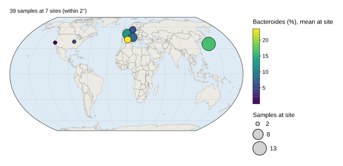

   The enterotype samples, one marker per site, sized by the number of
   samples and coloured by the mean abundance of *Bacteroides* there. Made
   with ``--plot-type map --color-by feature:Bacteroides``. The example data
   has no coordinates; ``Enterotypes.metadata.locations.tsv`` places each
   study's cohort at a city of its country, for illustration only.

**Sites.** Many samples are often taken at one place (a farm, a zoo, an
island). By default (*One marker per site*) samples whose coordinates fall in
the same cell of a grid are drawn as one marker: the cell is chosen so that
samples less than about 3 points apart on the page are merged (2° for a world
map 7 inches wide, 0.5° for a continent), or set by hand in degrees (*Site
size*, ``--map-site-precision``). Samples of different colours (or shapes)
at a site get a marker each, drawn largest first so that all stay visible.
Pointing at a marker lists the number of samples, where they are, their
groups and values, and the first few names. Without aggregation each
sample has a marker of its own; *Spread the samples of a site*
(``--map-jitter``) then arranges the samples at one place in a small spiral
around it instead of piling them up.

**Colours and shapes** are chosen as for the ordination plots (see
:ref:`ordination-colours`): the groups, a metadata field, a number on a
colour scale (linear or logarithmic), or a feature's relative abundance;
**Shape by** a categorical field. A site coloured by a number takes the
mean (or maximum, *Value of a site*) of its samples' values.

**Sizes.** Markers are sized by the number of samples at the site (the
default), a numeric field or a feature's abundance (the mean at the site),
or all the same. The area of a marker grows in proportion to the number,
from the smallest size to the largest (``--marker-size`` and
``--map-max-marker-size``, in square points), or with its logarithm
(*Logarithmic sizes*). The size legend shows the smallest, middle and
largest values.

**The map.** *Area*: around the samples (the default: their spread with a
margin, rounded to whole degrees; the whole world when they are spread over
much of it), the world, a continent (Europe, Africa, Asia, North America,
South America, Oceania), or a box of longitudes and latitudes
(``--map-extent -10,30,35,60`` for west, east, south, north). *Projection*:

* **Equal Earth** (the default): areas are true everywhere, so regions far
  from the equator are not enlarged;
* **Robinson**: a familiar compromise for world maps;
* **Equirectangular**: longitude and latitude as x and y;
* **Mercator**: shapes are true locally but areas grow towards the poles;
  cut at 85°.

The width of the figure is set and its height follows from the shape of the
area. The world is drawn inside the outline of the projection; smaller
areas in a rectangle with lines of longitude and latitude labelled along the
bottom and left. Coastlines, countries and large lakes come from `Natural
Earth <https://www.naturalearthdata.com/>`_ (public domain): the 1:110
million outlines for maps wider than 90° of longitude and the more detailed
1:50 million ones for smaller areas (*Detail*, ``--map-resolution``). The
sea colour, the outlines and the lines of longitude and latitude can be
switched off.

.. note::

   Natural Earth draws borders as they are administered (*de facto*), for
   example in Kashmir, Crimea and Western Sahara; they are shown for
   orientation only and imply no position on any dispute. The outlines are
   simplified, so a sample on a small island or right on a coast may appear
   just off the land at 1:110m.

**What to look for.** Whether the groups or the values follow geography:
samples of a group clustered in one region, or a feature abundant at some
sites and absent from others. Keep in mind how many samples each site stands
for (the marker size): a striking colour at a site with one sample says
little. Sites close together can hide each other on a world map; choose a
region or set a smaller site size to separate them.

