Plots explained
===============

The plot selector beneath the plot lists the plots available for the
current analysis under five headings, by the question they answer:

* `Differences between features`_: which features differ, and by how much?
* `One feature`_: what does the selected feature look like in every sample?
* `Composition`_: what are the samples made of?
* `Diversity`_: how rich and even are the samples?
* `Similarity between samples`_: how alike are the samples, and does that
  follow the groups or a measured number?

Every plot can be changed with **Configure plot** and saved with **File >
Save plot as**. Point at any part of a plot to see what it stands for.

.. note::

   The figures on this page were made from the example data: the iron mine
   samples of Edwards et al. (two samples, *Red* and *Black*), the
   enterotypes (two and multiple groups) and the coal seam gas samples
   (communities).

Differences between features
----------------------------

.. _plot-extended-error-bar:

Extended error bar
^^^^^^^^^^^^^^^^^^

*Two samples, two groups.* The main result plot of STAMP, and the first
shown for these analyses.

.. figure:: images/tg_extended_error_bar.png
   :width: 100%

   Genera that differ between Enterotype 1 and Enterotype 3 (p < 0.05).

Each row is a feature that passed the filters.

* **Left**: the proportion of the feature in each sample, or its mean
  proportion in each group.
* **Middle**: the difference between them (the effect size), with its
  confidence interval. The marker takes the colour of the sample or group
  in which the feature is more abundant. The dashed line marks zero: no
  difference.
* **Right**: the p-value (or q-value, under an FDR correction).

**What to look for.**

* Rows whose interval is far from zero and narrow: large, well-supported
  differences. Here *Bacteroides* (about 26 points higher in Enterotype 1)
  and the unclassified sequences (about 20 points higher in Enterotype 3).
* Rows whose marker sits on zero with a tiny interval, such as *Slackia*
  here: significant, but too small to matter. An effect size filter removes
  them.
* Long intervals: differences whose size is uncertain.

Rows can be sorted by p-value, effect size or name in *Configure plot*.

.. figure:: images/ts_extended_error_bar.png
   :width: 100%

   Subsystems that differ between the *Red* and *Black* iron mine samples,
   with Benjamini-Hochberg q-values.

Volcano plot
^^^^^^^^^^^^

*All analyses.* Every feature as a point: the effect size along the bottom,
and the significance (−log\ :sub:`10` of the p-value) up the side, so that
the more significant a feature, the higher it sits. The horizontal dashed
line marks the significance threshold.

.. figure:: images/tg_volcano.png
   :width: 80%

   Volcano plot of the genera of Enterotype 1 against Enterotype 3, with
   Benjamini-Hochberg q-values.

**What to look for.** The interesting features are in the **upper
corners**: large and significant. Points high up but near the middle are
significant but small; points far out to the side but low down are large
but uncertain (often rare, variable features). Here only two genera clear
the line after correction, one in each direction, and both have large
effects.

ANCOM plot
^^^^^^^^^^

*Two groups, multiple groups.* Each feature's W (how many of its log ratios
with other features differ between groups) against its effect size on the
CLR scale. Features called different are coloured and sit above the dashed
cut-off. See :ref:`the statistics page <ancom>` for how to read
it, with an example.

.. _plot-p-value-histogram:

p-value histogram
^^^^^^^^^^^^^^^^^

*Two samples, correlation.* The number of features with p-values in each
range, with an enlarged view of the p-values below 0.05.

.. figure:: images/ts_p_value_histogram.png
   :width: 70%

   Uncorrected p-values of the iron mine subsystems.

**What to look for.** If no feature truly differed, p-values would be spread
evenly from 0 to 1, giving a flat histogram. A **peak at the left** means
that some features truly differ; the higher the peak above the flat part,
the more of them. Here the peak is large, so many subsystems differ between
the two samples. A spike at exactly 1 is common with exact tests: rare
features with similar counts in both samples get a p-value of 1.

.. tip::

   A flat histogram with a few small p-values suggests that those p-values
   are mostly chance findings, however small they look. Choose whether to
   show corrected or uncorrected p-values in *Configure plot*; the
   uncorrected ones show this pattern best.

Multiple comparison plots
^^^^^^^^^^^^^^^^^^^^^^^^^

*Two samples.* Three views of the chosen multiple test correction: a
histogram of corrected p-values; corrected against uncorrected p-values;
and the number of features that would be significant at each threshold.

.. figure:: images/ts_multiple_comparison.png
   :width: 100%

   The Benjamini-Hochberg correction of the iron mine subsystems.

**What to look for.** The right-hand panel helps choose a threshold: here
about 50 features are significant at a q-value of 0.02, and few more are
added until about 0.06. The middle panel shows how much the correction
raised the p-values.

One feature
-----------

These plots show the feature selected in the feature table. Click another
feature to change it.

Bar plot
^^^^^^^^

*Two groups, multiple groups:* the feature's proportion in **every
sample**, coloured by group, with a line at each group's mean.

.. figure:: images/tg_bar.png
   :width: 70%

   *Prevotella* in every sample of Enterotypes 1 and 3.

**What to look for.** Whether a difference is shared by most samples of a
group or carried by a few. Here the mean of Enterotype 3 is pulled up by two
samples with 7 to 8% *Prevotella*; in the others it is as rare as in
Enterotype 1. This is why the difference is not significant (p = 0.17).

*Two samples:* a bar for each feature of a chosen statistic: sequences,
parent sequences, proportions, p-values (corrected or not) or effect
sizes.

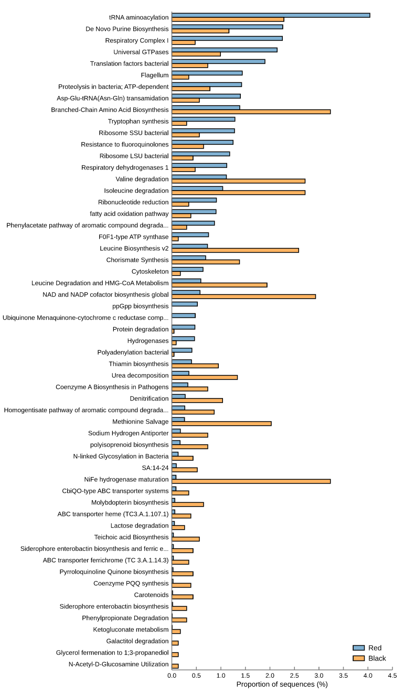

   The proportion of each significant subsystem in the two iron mine
   samples.

Box plot
^^^^^^^^

*Two groups, multiple groups.* The distribution of the feature's
proportion in each group.

.. figure:: images/tg_box.png
   :width: 70%

   *Prevotella* in Enterotypes 1 and 3.

How to read a box plot:

* the **box** spans the middle half of the samples (the 25th to 75th
  percentiles), and the **line** inside it is the median;
* the **whiskers** reach the most extreme samples within 1.5 box-lengths of
  the box;
* **crosses** are samples beyond the whiskers;
* the **star** is the mean.

**What to look for.** Overlap of the boxes; a mean (star) far from the
median, a sign that a few extreme samples dominate, as in Enterotype 3
here; and groups of very different spread, a reason to prefer Welch's test
or Games-Howell.

Post-hoc plot
^^^^^^^^^^^^^

*Multiple groups.* Every pair of groups compared for the selected feature,
as an extended error bar plot: mean proportions on the left, the difference
with its confidence interval in the middle, the p-value on the right. See
:ref:`post-hoc-tests` for an example.

As in STAMP 2, the plot starts by showing only the pairs of groups that
differ significantly; untick *Filter rows above nominal level* in
*Configure plot* to see every pair.

Correlation scatter plot
^^^^^^^^^^^^^^^^^^^^^^^^

*Correlation.* One point per sample: the number from the metadata along the
bottom, the feature's proportion up the side, with the least-squares line
and the correlation, its p-value and the number of samples. Points are
coloured by the groups of the group field.

**What to look for.** Whether the trend is carried by all samples or by one
or two at the end of the range; whether the relationship is a line or a
curve (use Spearman's correlation for curves); and whether the groups
form separate clouds, which can create a correlation across groups that
does not exist within any of them.

Composition
-----------

Composition bar plot
^^^^^^^^^^^^^^^^^^^^

*All except correlation.* Each sample (or each group's mean) as a stacked
bar of its most abundant features; the rest are added up as *Other*.

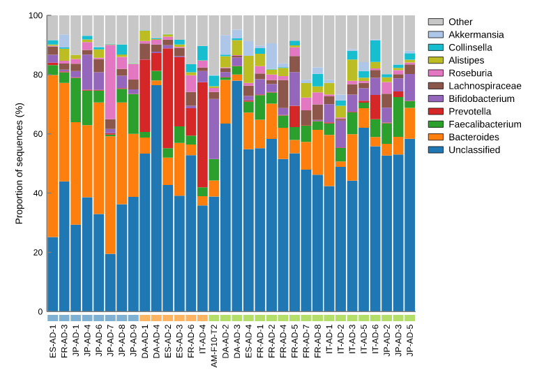

   Genus composition of the enterotype samples. The coloured strip beneath
   the bars shows each sample's group.

**What to look for.** Features that dominate some groups: here *Prevotella*
(red) is abundant in most samples of Enterotype 2 (orange strip) and rare
elsewhere, and *Bacteroides* (the orange segments) makes up more of the
Enterotype 1 samples. The number
of features shown is set in *Configure plot*.

Profile bar plot
^^^^^^^^^^^^^^^^

*Two samples.* The proportion of the most abundant features in both
samples, side by side, with 95% confidence intervals; a star marks
features that differ significantly.

.. figure:: images/ts_profile_bar.png
   :width: 100%

   The most abundant subsystems of the two iron mine samples.

Heatmap plot
^^^^^^^^^^^^

*Two groups, multiple groups.* Proportions of features (rows) in samples
(columns), as colours. Samples and features are clustered so that similar
ones sit together, with the tree of the clustering (dendrogram) along the
edges. The coloured strip above the samples shows their groups.

.. figure:: images/mg_heatmap.png
   :width: 90%

   Genera of the enterotype samples, clustered by average linkage.

**What to look for.** Whether samples of a group cluster together (here the
most of the Enterotype 2 samples, rich in *Prevotella*, form one
branch), and blocks of
colour marking features typical of a group. By default all features are
shown; *Configure plot* can limit it to the active features, change the
clustering method and the colours.

Scatter plot
^^^^^^^^^^^^

*Two samples, two groups.* Each feature as a point: its proportion in the
first sample or group along the bottom, in the second up the side. Features
on the dashed diagonal are equally abundant in both; points are coloured by
the sample or group in which they are more abundant. Bars show 95%
confidence intervals for two samples, and the spread within each group for
two groups (standard deviation, percentiles and others, chosen in
*Configure plot*). Histograms along the edges show how the proportions are
distributed.

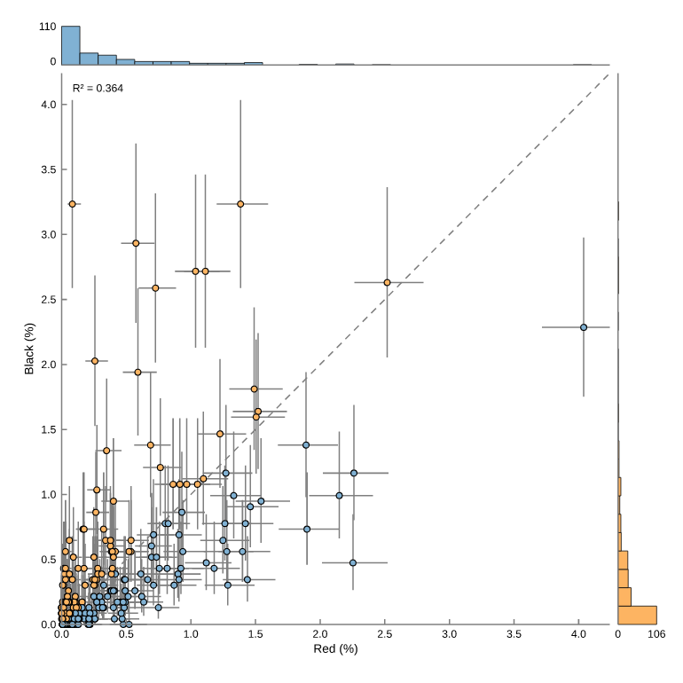

   Subsystems of the two iron mine samples.

**What to look for.** Points far from the diagonal. R² measures how well
the diagonal describes the points: near 1 means the two profiles are much
alike.

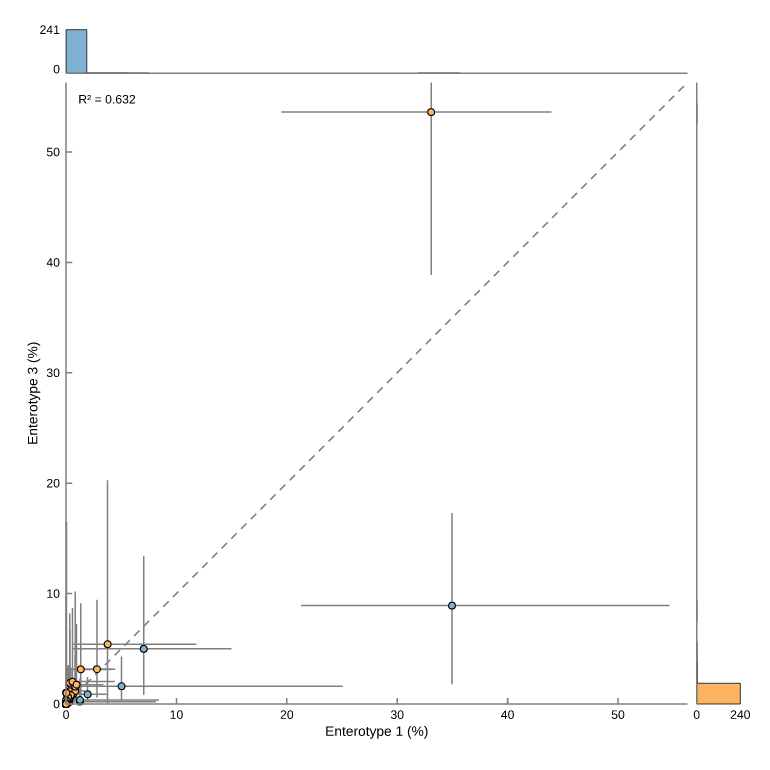

   Genera of Enterotypes 1 and 3, with the standard deviation of each
   group.

Shared features plot
^^^^^^^^^^^^^^^^^^^^

*All except correlation.* Which features each group has, and which they have
in common. A feature counts as present in a group if it is found in at least
a chosen share of the group's samples (50% by default).

The **UpSet plot** works for any number of groups. Each column is one
combination of groups, marked by the dots beneath it; its bar is the number
of features found in exactly that combination.

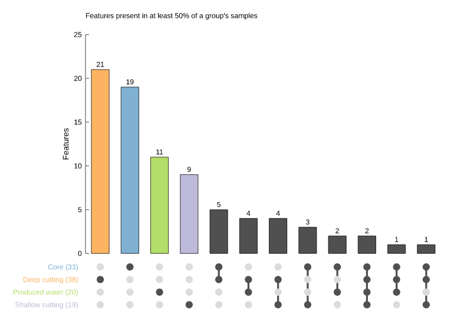

   Genera of the four coal seam gas sample types. The number beside each
   group is how many genera it has.

**Example.** 21 genera are found only in deep cuttings and 19 only in core;
5 are shared by core and deep cuttings only; just one is found in all four
sample types (the last column).

For two or three groups, a **Venn diagram** can be drawn instead.

.. figure:: images/tg_shared_venn.png
   :width: 70%

   Genera of core and produced water samples.

Sequence histogram
^^^^^^^^^^^^^^^^^^

*Two samples.* How many features have each number of sequences, in each
sample.

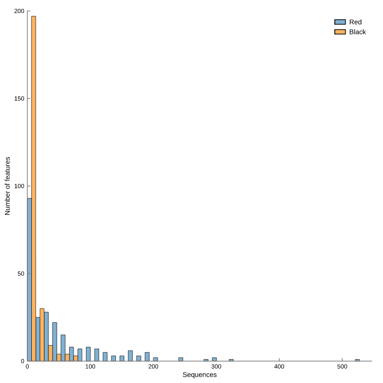

**What to look for.** If most features have only a few sequences, as in the
*Black* sample here, many will be too rare to test reliably; consider the
sequence filter, or a test suited to small counts such as Fisher's.

Diversity
---------

.. _plot-rarefaction:

Rarefaction curves
^^^^^^^^^^^^^^^^^^

*All except correlation; needs counts.* The number of features expected if
fewer sequences had been read. Each curve rises steeply at first, as common
features are found, and flattens as only rare ones remain to be found.

.. figure:: images/mg_rarefaction.png
   :width: 90%

   Rarefaction curve of every coal seam gas sample.

**What to look for.** A curve that has **levelled off** belongs to a sample
sequenced deeply enough to find most of its features. A curve still rising
steeply means more sequencing would find more features, and its count of
features is an underestimate. Compare samples at the same number of
sequences (a vertical line), not at their ends: samples that were sequenced
more deeply always end higher.

*Configure plot* draws a curve for each sample, for each group's pooled
sequences, or for each group **by number of samples**: how many features
would be found with fewer samples.

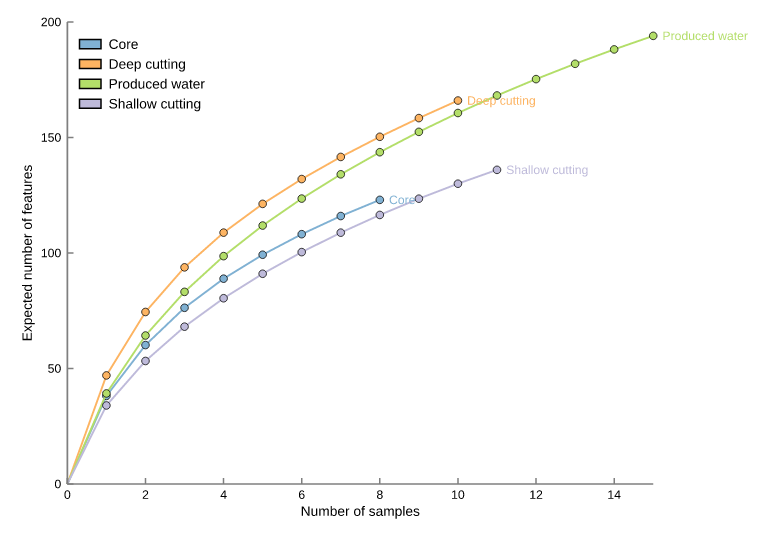

   Features found against number of samples, for each sample type.

Here no curve has levelled off: more samples of any type would find more
features.

Rank-abundance curves
^^^^^^^^^^^^^^^^^^^^^

*All except correlation.* Each sample's (or group's) features ordered from
the most abundant to the least, against their proportion on a logarithmic
scale.

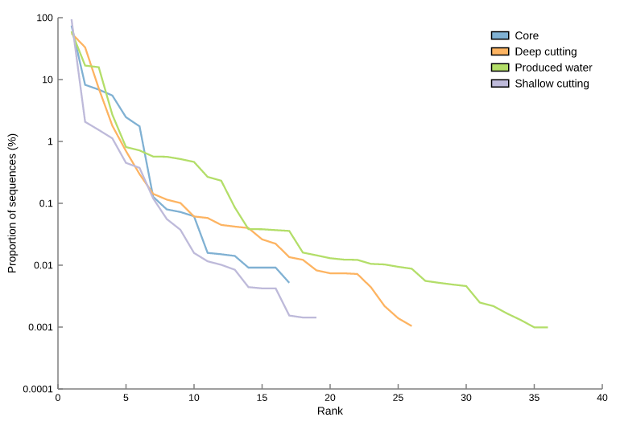

   Rank-abundance curves of the phyla in each coal seam gas sample type.

**What to look for.** A **steep** curve is a community dominated by a few
features; a **flat**, long curve is an even community with many features.
Here produced water has the longest, flattest tail: more phyla, more
evenly represented.

Alpha diversity box plot
^^^^^^^^^^^^^^^^^^^^^^^^

*Two groups, multiple groups.* The diversity of each sample, by group, as
box plots, with a Kruskal-Wallis test of whether the groups differ. The
measure (observed features, Shannon, Simpson, Chao1) is chosen in
*Configure plot*; see :doc:`statistics` for what each means.

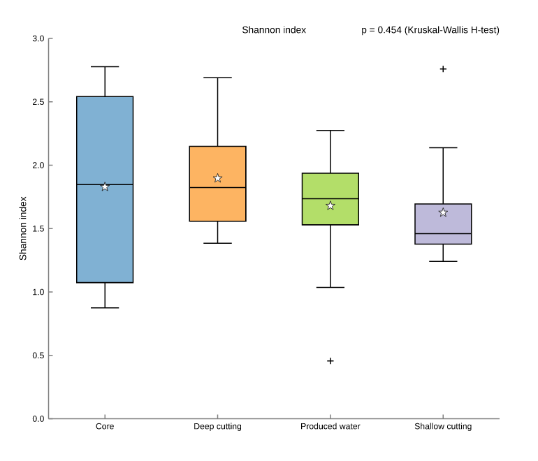

   Shannon diversity of the coal seam gas samples.

**Example.** The medians differ a little, but the boxes overlap broadly and
the Kruskal-Wallis p-value is 0.45: no evidence that the sample types differ
in diversity. They may still differ in *which* organisms they contain (see
the PCoA plot of the same samples in :doc:`statistics`).

Similarity between samples
--------------------------

These plots place samples so that similar samples are close together.
*Ordination* is the general name for this: a map of many dimensions (one
per feature) squeezed into two that keep as much of the picture as
possible.

PCA plot
^^^^^^^^

*Two groups, multiple groups.* Principal component analysis of the
proportions of all features. The first principal component (PC1) is the
direction in which the samples vary most; PC2 the next, at right angles to
it; and so on. Three panels show PC1 against PC2, PC3 against PC2 and PC1
against PC3. Each axis gives the share of all variation it captures.

.. figure:: images/mg_pca.png
   :width: 90%

   PCA of the genera of the three enterotypes.

**What to look for.** Whether groups form separate clouds. Here
Enterotype 1 is separated from the others along PC1, which captures 57% of
the variation, and Enterotype 2 along PC2. If the first two axes together
capture little of the variation, the plot shows only a small part of the
picture.

.. tip::

   PCA of proportions is dominated by the most abundant features. To see
   whether the groups differ in the rest of the community too, use the PCoA
   plot with the Jaccard distance.

PCoA plot
^^^^^^^^^

*Two groups, multiple groups.* Principal coordinates analysis: like PCA,
but built from a chosen distance between samples (Bray-Curtis, Jaccard or
Aitchison), which suits community data better. Above the plot are the
results of PERMANOVA, ANOSIM and PERMDISP, whether the groups differ as a
whole. See :ref:`the community tests <community-tests>` for an
example of how to read them.

NMDS plot
^^^^^^^^^

*Two groups, multiple groups.* Non-metric multidimensional scaling: places
the samples in two dimensions so that the *order* of the distances between
them is kept as well as possible. It makes no assumption about the shape of
the data, and often separates groups more clearly than PCoA. The axes have
no units, and only the relative positions of samples mean anything.

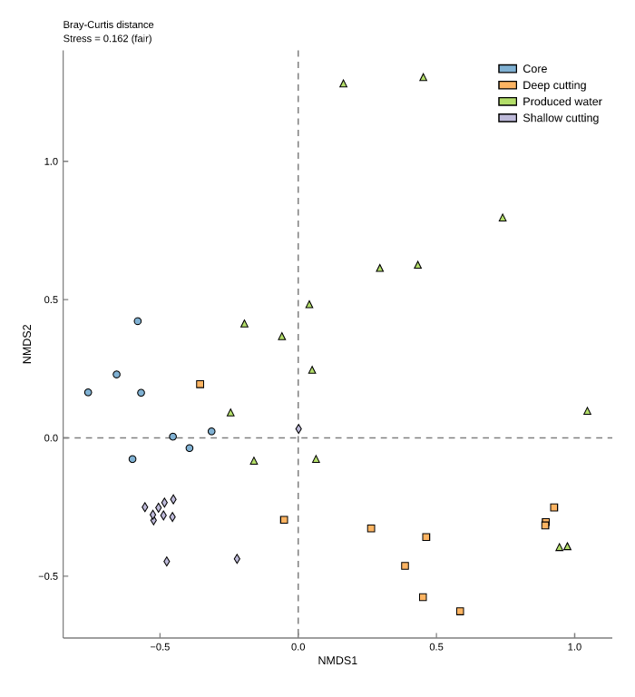

   NMDS of the coal seam gas samples (Bray-Curtis distance).

**What to look for.** First the **stress** above the plot (here 0.16,
fair): see :ref:`nmds-stress`. Then the groups: here the shallow
cuttings form a tight cluster, core samples sit beside them, and deep
cuttings and produced water spread widely.

.. _plot-distance-box:

Distance box plot
^^^^^^^^^^^^^^^^^

*Two groups, multiple groups.* The distances between every pair of samples
of each group, and between samples of different groups (the last box).

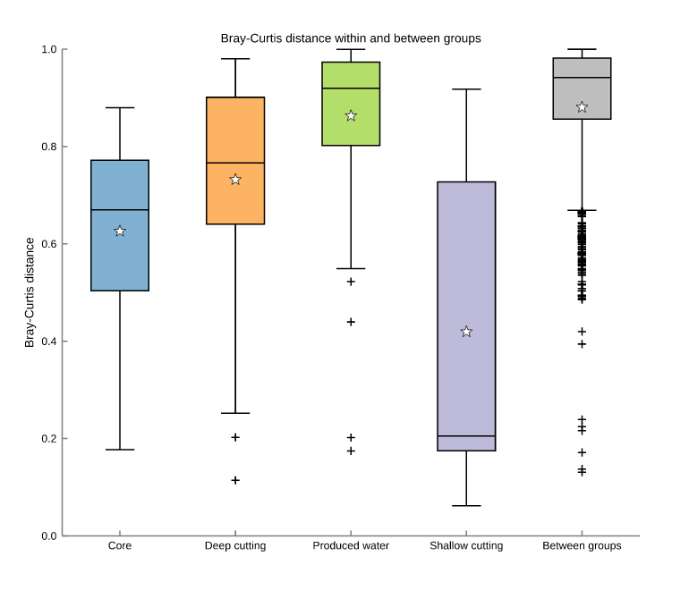

   Bray-Curtis distances within each coal seam gas sample type, and between
   types.

**What to look for.** Groups whose distances are smaller than those between
groups are distinct communities. A group whose distances are small (here
the shallow cuttings, median about 0.2) is uniform; one whose distances are
large (produced water, about 0.9) is variable, almost as different within
itself as from the other groups. Differences in these boxes are what
PERMDISP tests.

Mantel test plot
^^^^^^^^^^^^^^^^

*Correlation.* One point per **pair** of samples: the difference in the
metadata number between the two samples along the bottom, the distance
between their communities up the side. Above the plot is the Mantel test of
whether the two are correlated.

**What to look for.** A rising cloud of points and a significant Mantel
test: samples that differ more in the number differ more in composition. A
flat cloud, as is common, means composition does not follow the number.
There are many points (one per pair), so the plot can look like a strong
pattern even when the correlation is weak; trust the test, not the eye.
