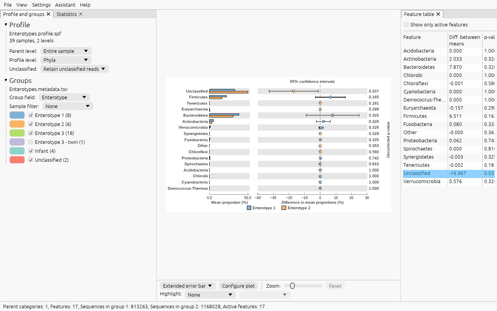
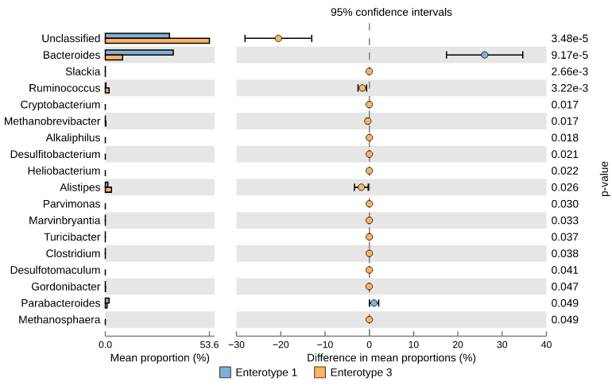

Quick start
===========

This walk-through uses the enterotype data set that comes with STAMP:
genus-level profiles of 39 human faecal metagenomes, classified into three
"enterotypes" by Arumugam et al. (2011, *Nature* 473:174). It takes about
ten minutes.

Open the example
----------------

Start STAMP and choose **File > Open example data > Enterotypes**. This
loads a profile (how many sequences of each phylum and genus each sample
contains) and its metadata (what is known about each sample).

   The STAMP window with the enterotype example loaded.

The window has these parts:

* **Left: profile and groups.** The level to analyse (phyla or genera), and
  the groups of samples defined by a metadata field. Here the field is
  *Enterotype*, giving groups such as *Enterotype 1 (8)*, with the number of
  samples in brackets. Untick a group to leave it out.
* **Left, the Statistics tab.** The kind of analysis (tabs at the top), the
  statistical test, and the filters that decide which features count as
  "active". Click the tab beside *Profile and groups* to see it.
* **Centre: the plot**, with the choice of plot beneath it.
* **Right: the feature table**, every feature with its effect size and
  p-value. Click a feature to show it in the plots of a single feature.
* **Bottom: the status bar**, summarising the profile being analysed.

Compare several groups
----------------------

Open the **Statistics** tab on the left and click its **Multiple groups**
tab. STAMP tests every genus (choose *Genera* as the profile level in
*Profile and groups*) for a difference between the ticked groups with an
ANOVA, and shows a **PCoA plot**: each point is a
sample, placed so that samples with similar profiles are close together.
The three enterotypes form fairly separate clouds, which is how they were
defined, and the PERMANOVA above the plot confirms that they differ.

.. tip::

   Untick the groups with very few samples (*Enterotype 3 - twin*,
   *Unclassified*, *Infant*) to compare only the three enterotypes.

Choose **Heatmap plot** from the plot selector beneath the plot. The heatmap
shows the proportion of every genus in every sample, with similar samples
and similar genera placed next to each other. Look for blocks of colour: a
genus that is abundant in one group of samples and rare in the others.

Now click **Prevotella** in the feature table, and choose **Box plot**. The
box plot shows the proportion of *Prevotella* in each group: it is abundant
in Enterotype 2 and nearly absent from the others. The **Post-hoc plot**
answers the next question, *which* groups differ: it compares every pair of
groups, with a confidence interval for each difference. An interval that
does not cross zero marks a pair of groups that differ.

Compare two groups
------------------

In the **Statistics** tab, click the **Two groups** tab and choose
*Enterotype 1* as group 1 and *Enterotype 3* as group 2. The test is now Welch's t-test, and the plot is
an **extended error bar plot**:

   Extended error bar plot of Enterotype 1 against Enterotype 3, keeping
   features with a p-value of 0.05 or less.

Each row is a genus. On the left are its mean proportions in the two
groups; in the middle, the difference between them with its 95% confidence
interval; on the right, the p-value. Here *Bacteroides* makes up about 26
percentage points more of Enterotype 1, while sequences that could not be
assigned to a genus (*Unclassified*) make up about 20 points more of
Enterotype 3.

.. tip::

   Look at the rows below *Ruminococcus*: genera such as *Slackia* have
   p-values below 0.05, but their difference is so close to zero that the
   confidence interval is hidden behind the marker. A difference can be
   *statistically* significant and still too small to matter biologically.
   This is why STAMP shows the size of every difference, and why it can
   filter features by effect size as well as by p-value (see
   :doc:`analyses`).

Account for testing many features
---------------------------------

STAMP tests every genus at once, so some small p-values are expected by
chance alone. Set **Multiple test correction** to *Benjamini-Hochberg FDR*.
The p-values become q-values (corrected p-values), and the q-value filter
keeps features whose q-value is 0.05 or less. See
:ref:`multiple-testing` for what this means.

Save the results
----------------

* **File > Save plot as** saves the plot as PNG, SVG or PDF. SVG and PDF
  keep the text editable in a drawing program.
* **File > Save results table** saves a table of every feature, with its
  statistics, as tab-separated text that opens in a spreadsheet.
* **Configure plot** (beneath the plot) changes the size, colours and other
  options of the current plot; **Settings > Preferences** changes the fonts
  and colours of every plot.

Next steps
----------

* Load your own data: see :doc:`input_files`.
* Work through a larger data set, 1,289 gut metagenomes of mammals with
  many host groups (**File > Open example data > Eggerthellaceae**): see
  :doc:`example_eggerthellaceae`.
* Learn what each test does and how to read it: :doc:`statistics` and
  :doc:`choosing_a_test`.
* Learn what each plot shows: :doc:`plots`.
