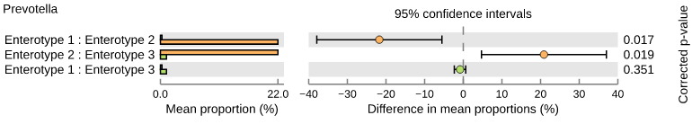
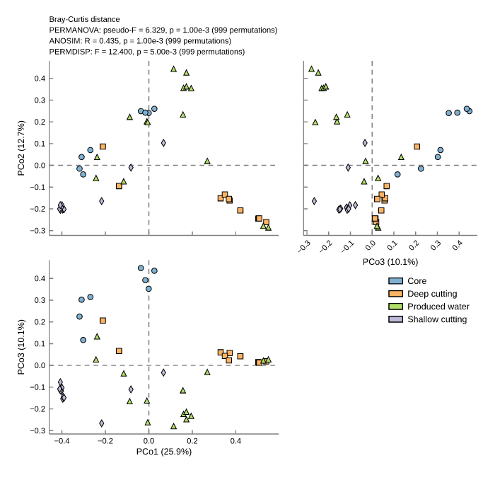
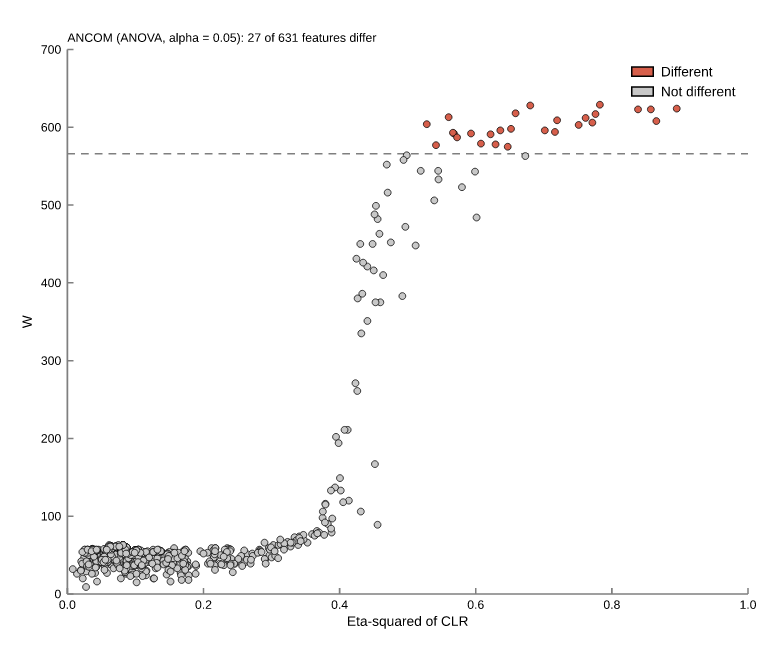

Statistics explained
====================

This page explains the statistics STAMP uses, what each one tells you and
how to read it. It assumes no more statistics than an undergraduate course;
where a formula helps, it is given in words. The tests are grouped by the
kind of analysis they belong to (see :doc:`analyses`); for help choosing
among them, see :doc:`choosing_a_test`.

Ideas used throughout
---------------------

Features are tested one at a time
^^^^^^^^^^^^^^^^^^^^^^^^^^^^^^^^^

Except for the community tests at the end of this page, every test in
STAMP asks a question about **one feature** (a genus, a pathway, a gene
family) and is repeated for every feature in the profile. Each feature is
measured as a **proportion**: the share of a sample's sequences that belong
to it, shown as a percentage. Using proportions makes samples sequenced to
different depths comparable.

p-values
^^^^^^^^

Every test starts from a **null hypothesis**: the feature makes up the same
proportion of both samples, or has the same average in every group. The
**p-value** is the probability of seeing a difference at least as large as
the one observed *if the null hypothesis were true*.

* A small p-value (by convention, below 0.05) says the data would be
  surprising if nothing were going on, which is taken as evidence of a real
  difference.
* A large p-value says the data are consistent with no difference. It does
  **not** show that there is no difference: the study may have had too few
  samples to detect it.
* A p-value says nothing about how *large* or how *important* a difference
  is. With thousands of sequences or hundreds of samples, a trivial
  difference can have a tiny p-value.

.. tip::

   Read a p-value together with the effect size and its confidence interval.
   "The genus makes up 26 percentage points more of group 1 (95% confidence
   interval 15 to 37, p = 0.0002)" is far more informative than
   "p = 0.0002".

Effect sizes
^^^^^^^^^^^^

An **effect size** says how large a difference is, in units that mean
something biologically. STAMP's effect sizes are:

Difference between proportions (DP)
   The proportion in the first sample or group minus that in the second, in
   percentage points. A feature making up 12% of one group and 4% of the
   other has a DP of 8. Positive values mean the feature is more abundant
   in the first sample or group.

Ratio of proportions (RP)
   The proportion in the first divided by that in the second. An RP of 3
   means three times as abundant; 0.5 means half as abundant. Ratios suit
   rare features, where a difference of 0.1 percentage points may be a
   ten-fold change. A small *pseudocount* (set in the preferences) is added
   where a feature is absent, so that the ratio stays finite.

Odds ratio (OR, two samples)
   The odds of a sequence belonging to the feature in the first sample,
   divided by the same odds in the second. For rare features it is nearly
   the same as the ratio of proportions.

Eta-squared (multiple groups)
   The share of the variation in the feature's proportion that is explained
   by which group a sample belongs to, from 0 (the groups have the same
   mean) to 1 (all variation is between groups, none within them). Values
   above about 0.14 are often called large.

Correlation coefficient (correlation)
   *r* or *rho*, from −1 to 1; see `Correlation`_.

Confidence intervals
^^^^^^^^^^^^^^^^^^^^

A **95% confidence interval** is a range of plausible values for the true
effect size: computed the same way in many repeated studies, 95% of such
intervals would contain the true value. Its width shows how precisely the
data pin the effect down.

* For a **difference**, an interval that does not include **zero** means
  the difference is significant at the 5% level; one that crosses zero means
  it is not.
* For a **ratio**, the corresponding value is **one**.
* A narrow interval far from zero is a large, well-supported difference.
  A wide interval that only just misses zero is a difference whose size is
  very uncertain: it may be large or tiny.

*Coverage* in the statistics panel sets the confidence level (0.95 for 95%).

One-sided and two-sided tests
^^^^^^^^^^^^^^^^^^^^^^^^^^^^^

A **two-sided** test asks whether the feature differs in either direction;
a **one-sided** test asks only whether it is larger in the first sample or
group. A one-sided test has more power in the direction it looks, but none
in the other, and it is only valid if the direction was chosen before the
data were seen. When in doubt, use two-sided tests.

Resampling and the random seed
^^^^^^^^^^^^^^^^^^^^^^^^^^^^^^

Several methods (bootstrap and permutation tests, White's test, Storey's
FDR, the community tests) work by reshuffling or resampling the data
thousands of times. Their results vary slightly with the random numbers
drawn. STAMP uses a fixed **random seed** (Settings > Preferences), so the
same data give the same results every time; changing the seed shows how
much the results depend on chance.

A resampling p-value can only be as fine as the number of replicates
allows. With 999 permutations, the community tests cannot report a p-value
below 0.001, and a p-value of 0.001 then means "0.001 or less"; the
two-sample bootstrap and permutation tests report 0 when no replicate was
as extreme as the data, which likewise means "less than about one in the
number of replicates". Use more replicates if a finer value matters.

.. _multiple-testing:

Testing many features: multiple test correction
^^^^^^^^^^^^^^^^^^^^^^^^^^^^^^^^^^^^^^^^^^^^^^^

A profile may have hundreds of features. If none truly differed, testing
500 of them at p < 0.05 would still find about 25 "significant" features by
chance alone. A **multiple test correction** adjusts the p-values to allow
for the number of tests. STAMP offers two kinds.

**Family-wise error rate (FWER) corrections** keep the chance of even *one*
false positive among all features below 5%. They are strict, and suit
studies where a single false claim is costly, or where few features are
tested.

* **Bonferroni**: multiplies each p-value by the number of features. Simple
  and very conservative.
* **Holm-Bonferroni**: a step-wise version of Bonferroni that is never less
  powerful and controls the same error. Prefer it to Bonferroni.
* **Sidak**: slightly less conservative than Bonferroni when the tests are
  independent.

**False discovery rate (FDR) corrections** control the expected *share* of
false positives among the features called significant. A cut-off of 0.05
means that, on average, about 5% of the features kept are false
discoveries. This is the usual choice for exploratory studies of many
features, where some false leads are acceptable if most findings are real.
The corrected values are called **q-values** (see :ref:`how plots name
p-values <p-value-labels>`).

* **Benjamini-Hochberg FDR**: the standard method.
* **Storey FDR**: estimates the proportion of features that truly do not
  differ (*pi_0*, shown under *Correction info*) and uses it to gain power.
  When many features really differ, it finds more of them than
  Benjamini-Hochberg. The estimate is the share of p-values above a
  cut-off (*lambda*), so it needs many features with a flat run of high
  p-values; with a few dozen features it rests on a handful of p-values
  and can be far too low, which makes every q-value too small. STAMP uses
  the estimate only when its standard error is at most a quarter of it
  (roughly, when 16 or more p-values lie above *lambda*) and some p-value
  reaches 0.95, as R's *qvalue* requires. Otherwise it takes *pi_0* = 1,
  which gives the Benjamini-Hochberg q-values, and says so under the
  correction. *Correction info* shows the estimate, *lambda*, how many
  p-values lie above it, the standard error and the *pi_0* used.

.. tip::

   * With **No correction**, treat significant features as hypotheses to
     check, not findings.
   * If nothing survives a correction, the study may simply lack the samples
     to detect differences of the size present. The effect sizes and
     confidence intervals still describe what the data show.
   * The **p-value histogram** shows whether there is anything to find: see
     :ref:`plot-p-value-histogram`.

Two samples
-----------

With one sample on each side, each feature is summarised by four counts:
its sequences in each sample, and the other sequences of each sample. The
tests ask whether the feature's share differs between the two samples more
than random sampling of sequences would explain.

.. important::

   These tests treat each **sequence** as an independent observation. They
   can show that two *samples* differ, but not that the environments or
   treatments they came from differ: a second sample from the same site
   would also differ from the first. To compare conditions, sequence
   replicate samples and use :ref:`two-group tests <stats-two-groups>`.

Statistical tests
^^^^^^^^^^^^^^^^^

The list of tests starts with the two to choose from:

G-test (w/ Yates') + Fisher's
   Uses Fisher's exact test when any of the four counts is below 20, and the
   G-test with Yates' correction otherwise. This is STAMP's default: exact
   where it matters, fast where it does not.

Fisher's exact test
   Computes the p-value exactly, from all ways the sequences could be split
   between the samples. Valid for any counts, including very small ones.
   Slow only for very large counts.

Below a line come the other tests:

G-test, G-test (w/ Yates')
   A test of a 2×2 table based on the likelihood ratio, using an
   approximation that is accurate when every count is large (as a rule of
   thumb, at least 5 to 20). Yates' correction makes the approximation more
   cautious for smaller counts. Two-sided only.

Chi-square test, Chi-square test (w/ Yates')
   The classic test of a 2×2 table, with the same kind of approximation as
   the G-test, and very similar results. Two-sided only.

Difference between proportions
   A z-test on the difference between the two proportions, using the
   pooled proportion. Its two-sided p-value is that of the chi-square test
   (without Yates' correction); it also gives a one-sided p-value.

Hypergeometric
   The one-sided Fisher's exact test; its two-sided p-value is twice the
   smaller tail. Close to Fisher's test.

Bootstrap, Permutation
   Resampling tests. Both simulate many pairs of samples in which the
   feature has the same proportion, and ask how often a difference as large
   as the observed one arises. The **bootstrap** draws each simulated
   sample's sequences from the pooled proportion; the **permutation** test
   reshuffles the pooled sequences between the two samples. They need no
   approximation but take longer, and their p-values are limited by the
   number of replicates.

.. note::

   The tests below the line are kept for compatibility with STAMP v2, so
   that analyses made with it can be repeated, and scripts that use them
   keep working. None gives anything the first two do not:

   - The **chi-square** and **G-tests** approximate what Fisher's exact test
     computes exactly; they agree with it for abundant features and are
     less reliable for rare ones, which is where the default switches to
     Fisher's test.
   - The **difference between proportions** gives the chi-square test's
     p-value.
   - The **permutation** test keeps the totals of both samples and of the
     feature fixed, as Fisher's test does, so it estimates Fisher's p-value
     by resampling: the same answer with random error, more slowly, and
     never below about one in the number of replicates. After correction
     for testing hundreds of features, that limit can hide real
     differences. The **bootstrap** does not keep the totals fixed, but has
     the same limit.

.. tip::

   Fisher's exact test or the default G-test + Fisher's are good choices for
   almost every data set. The approximate tests give nearly the same
   answers for abundant features and differ mainly for rare ones, where the
   exact test is the one to trust.

Confidence intervals
^^^^^^^^^^^^^^^^^^^^

The *CI method* sets both the effect size and how its interval is
calculated. The name says which effect size: **DP** (difference between
proportions), **RP** (ratio of proportions) or **OR** (odds ratio).

DP: Asymptotic
   The textbook interval (difference ± 1.96 standard errors). Too narrow
   when counts are small.

DP: Asymptotic-CC
   The same with a continuity correction, which widens it slightly for
   small counts. The window's default for two samples, as in STAMP 2.

DP: Newcombe-Wilson
   Built from the Wilson interval of each proportion. Reliable even for
   small counts and proportions near zero; the best general choice.

RP: Asymptotic
   Interval for the ratio of proportions, computed on the log scale.

OR: Haldane adjustment
   Interval for the odds ratio, computed on the log scale. When any count
   is zero, a small amount (the pseudocount) is added to every count
   (Haldane's adjustment) so that the ratio stays finite.

.. _stats-two-groups:

Two groups
----------

With several samples in each group, each feature is summarised by its
proportion in every sample, and the tests ask whether the groups differ
more than the samples within each group differ from one another. This is
what most studies need: the replicates show how much a feature varies
naturally, and a difference between groups must stand out from that.

The effect size is the **difference between the mean proportions** of the
two groups (or their ratio).

Statistical tests
^^^^^^^^^^^^^^^^^

Welch's t-test
   Compares the group means, allowing each group its own variance. It is
   reliable even when the groups differ in size and spread, and is STAMP's
   default. Its interval (*DP: Welch's inverted*) is the matching interval
   for the difference in means.

t-test (equal variance)
   Student's t-test, which assumes the two groups vary equally. When that is
   not true, especially with groups of different sizes, its p-values can be
   misleading. Welch's test is almost always the safer choice.

White's non-parametric t-test
   A permutation test on the t statistic (White et al. 2009, *PLoS Comput
   Biol* 5:e1000352): the samples are shuffled between the groups many times
   to see how often a t statistic as large as the observed one arises. It
   makes no assumption about the shape of the data and suits small groups.
   For sparse features (fewer sequences in a group than samples), it pools
   the counts of each group and uses Fisher's exact test. Its interval comes
   from the bootstrap.

   The method is that of the authors' R code (Metastats). The t statistic
   is Welch's; when either group has fewer than 8 samples, the shuffled
   statistics of all features that are not sparse are pooled into one null
   distribution, otherwise each feature has its own and its p-value is
   (more extreme + 1) / (permutations + 1). Each group needs at least two
   samples. The results are tested against R: the statistic against
   ``t.test``, the p-values against the exact permutation p-values found
   by trying every division of the samples into the two groups, and sparse
   features against ``fisher.test``. Two details differ from Metastats: a
   pooled p-value is divided by the number of pooled statistics (Metastats
   divides by one feature's worth more, which makes its pooled p-values too
   small), and STAMP also gives a one-sided p-value.

Mann-Whitney U test
   Also called the Wilcoxon rank-sum test. Ranks all the samples together
   and asks whether one group's samples tend to rank higher. It uses ranks
   rather than values, so a few extreme samples cannot drive the result,
   and it makes no assumption about the shape of the data. The interval for
   the difference in means comes from the bootstrap.

Paired t-test
   For paired samples (see :ref:`paired-tests`): tests whether the mean of
   the differences within pairs is zero.

Wilcoxon signed-rank test
   The rank-based version of the paired t-test: tests whether the
   differences within pairs tend to be positive or negative. Robust to
   extreme pairs. Its interval comes from the bootstrap.

Fisher's exact test (presence/absence)
   Asks a different question from the tests above: not whether a feature
   is more *abundant* in one group, but whether it is *found* in more of
   that group's samples. Each sample counts as having the feature (any
   sequences at all) or not, and the test compares the two groups' shares
   of samples that have it. It is exact for any number of samples. Use it
   for features that are absent from many samples, where a difference in
   mean proportion says little. The effect size and its interval remain
   the difference in mean proportions (from the bootstrap), since the test
   itself measures no size; the **prevalence-abundance plot** shows the
   shares themselves.

McNemar's test (presence/absence)
   The same question for paired samples (see :ref:`paired-tests`): among
   the pairs in which only one of the two samples has the feature, is it
   more often the sample of one group? Pairs in which both or neither have
   it say nothing. The exact form of the test is used.

.. tip::

   * **Do the t-tests need normally distributed data?** Less than often
     thought. With about ten or more samples per group, the t-tests work
     well even for skewed data. With fewer, or with a few very extreme
     samples, compare with the Mann-Whitney U test or White's test: if they
     agree, the conclusion is robust.
   * **Rank tests with very small groups** cannot reach small p-values: with
     three samples in each group, the smallest two-sided Mann-Whitney
     p-value is 0.1, however large the difference.
   * A feature found in only one or two samples of a group can produce a
     "significant" mean difference that rests on those samples. Check the
     **box plot** or **bar plot** of any feature you plan to report.

.. _clr:

Centred log-ratio transform
^^^^^^^^^^^^^^^^^^^^^^^^^^^

Proportions always add up to 100%. If one feature blooms, every other
feature's *proportion* falls, even if its actual abundance did not change.
Data of this kind are called **compositional**, and they can make features
appear to differ when they do not.

The **centred log-ratio** (CLR) transform replaces each proportion by the
logarithm of the feature's abundance relative to the geometric mean of all
features in that sample. Ratios between features do not depend on the rest
of the sample, so a bloom of one feature no longer drags the others down.
With *Transform* set to *Centred log-ratio*, the p-values of the two-group
and multiple-group tests are computed on CLR values; effect sizes,
confidence intervals and plots stay in proportions, which are easier to
read. Zeros are replaced by a small value before the logarithm is taken.

.. tip::

   Try both. Features significant on both scales are the most robust
   findings. A feature significant only on proportions may be riding on a
   large change in some other feature.

Multiple groups
---------------

Statistical tests
^^^^^^^^^^^^^^^^^

ANOVA
   One-way analysis of variance: do the group means differ by more than the
   variation within groups would explain? The multiple-group equivalent of
   the t-test, and STAMP's default. It assumes the groups are about equally
   spread out (see `Equal spread`_).

Welch's ANOVA
   Welch's (1951) analysis of variance: like ANOVA, but each group is
   weighted by how closely its samples agree (its size over its variance),
   so the groups need not be equally spread out. The multiple-group
   equivalent of Welch's t-test (with two groups it gives exactly the same
   p-value), and the overall test that belongs with the Games-Howell
   post-hoc test. Prefer it to ANOVA when the groups differ in size or in
   spread; with equal groups it loses little. The p-values are those of R's
   ``oneway.test(var.equal = FALSE)``. A group in which the feature has the
   same value in every sample (often: absent from all of them) has no
   variance and so infinite weight, which ``oneway.test`` cannot use; STAMP
   takes the test at its limit, comparing the other groups with that
   value, as Welch's t-test does. Constant groups with different values
   give p = 0, as for ANOVA.

Kruskal-Wallis H-test
   The rank-based equivalent of ANOVA, and the multiple-group equivalent of
   the Mann-Whitney test. Robust to skewed data and extreme samples.

Friedman test
   For **matched groups**: the same subjects (patients, sites) sampled once
   in every group, such as several time points. It is the rank-based test
   for this design, the multiple-group equivalent of the Wilcoxon
   signed-rank test: each subject's values are ranked across the groups,
   and the test asks whether some groups tend to rank higher. Because every
   subject is compared only with itself, differences between subjects do
   not hide a consistent change. Choose the **Subject field**, the metadata
   field that names the subject of each sample; subjects without exactly
   one sample in every group are left out.

Chi-square test (presence/absence)
   Asks whether a feature is *found* in the same share of the samples of
   every group, whatever its abundance where it is found: the
   multiple-group equivalent of Fisher's exact test of presence. A note
   marks features for which a group is expected to hold fewer than five
   samples with (or without) the feature, where the test's approximation is
   rough.

All of them answer only whether *some* groups differ. To find which, use a
post-hoc test.

The effect size is **eta-squared** (see `Effect sizes`_).

.. _equal-spread:

Equal spread
^^^^^^^^^^^^

ANOVA and the Tukey-Kramer test assume that the groups are about equally
spread out; when they are not, and especially when the groups also differ
in size, their p-values can be far too small or too large. Every
multiple-group analysis therefore also runs the **Brown-Forsythe test**
(Brown and Forsythe 1974) on each feature: Levene's test of equal variances
on the distances of the values from their group's *median*, which, unlike
Levene's original test about the means, is robust to skewed data. It is an
ANOVA of those distances; the p-values are those of R's
``car::leveneTest`` or ``DescTools::LeveneTest`` with their default
``center = median``. It is computed on the values the main test sees (the
centred log-ratios, if that transform is chosen), and needs two samples in
every group.

Each feature's p-value is in the last column of the results table,
**Equal spread p-value (Brown-Forsythe)**, uncorrected. Under the
statistics a summary counts the features whose spread differs (p < 0.05):

   Brown-Forsythe test: the spread differs between the groups for 814 of
   1936 features (42%; p < 0.05, 5% expected by chance).

By chance alone about 5% of the features would differ. When clearly more
do (over 10%) and the test is ANOVA, a caution suggests **Welch's ANOVA**
with the **Games-Howell** post-hoc test; the analysis wizard uses the same
rule to choose between them (see :doc:`wizard`). The check informs the
choice of test: STAMP never switches the test because of it. The test of
presence and the Friedman test do not compare spreads, and show no
summary.

**Example.** The glacier-fed stream sediments, at family level and grouped
by mountain range, differ in spread for 42% of the families, and the
groups range from 2 to 37 samples: Welch's ANOVA and Games-Howell are the
better choice. The three enterotypes differ in spread for 14 of 248
genera (6%), as chance would give, and ANOVA serves.

.. _post-hoc-tests:

Post-hoc tests
^^^^^^^^^^^^^^

A post-hoc test compares every pair of groups for one feature (the one
selected in the feature table), shown in the **post-hoc plot**. Each pair
gets a difference in mean proportion, its confidence interval and a
p-value. Comparing many pairs raises the same problem as testing many
features, so most post-hoc tests widen their intervals to allow for the
number of pairs.

Tukey-Kramer
   The standard choice after ANOVA. Allows for the number of pairs while
   keeping good power. Assumes the groups vary about equally.

Games-Howell
   Like Tukey-Kramer but allows each group its own variance; the post-hoc
   counterpart of Welch's t-test, and the post-hoc test that goes with
   Welch's ANOVA (choosing Welch's ANOVA switches the post-hoc test from
   Tukey-Kramer to Games-Howell). A good choice when groups differ in size
   or spread.

Scheffè
   Very conservative: valid for any comparison of groups, not only pairs,
   so it is less likely than the others to call a pair different.

Welch's (uncorrected)
   A Welch's t-test for each pair, *without* allowing for the number of
   pairs. More pairs will look significant, so treat its results as
   exploratory.

Dunn's test (Bonferroni)
   The rank-based post-hoc test that goes with the Kruskal-Wallis test. Its
   p-values are multiplied by the number of pairs. It tests ranks, so its
   interval for the difference in means is Welch's interval at the
   correspondingly stricter confidence level.

Wilcoxon signed-rank (Holm)
   The post-hoc test for matched groups, which goes with the Friedman test
   (and is the only one offered with it): a Wilcoxon signed-rank test for
   each pair of groups, with p-values corrected for the number of pairs by
   Holm's method. Its interval is that of the paired t-test at the
   correspondingly stricter confidence level.

   Post-hoc plot of *Prevotella* in the three enterotypes (Games-Howell).

**Example.** In the figure above, the interval for *Enterotype 1 :
Enterotype 2* lies entirely below zero (p = 0.017): *Prevotella* is about
22 percentage points less abundant in Enterotype 1. *Enterotype 2 :
Enterotype 3* lies entirely above zero (p = 0.019). The interval for
*Enterotype 1 : Enterotype 3* crosses zero (p = 0.351): these two
enterotypes cannot be told apart by *Prevotella*. Note how wide the first
two intervals are (from about 5 to 38 points): the difference is clearly
real, but its size is uncertain with this few samples.

.. tip::

   Use the post-hoc test that matches the main test: Tukey-Kramer or
   Games-Howell after ANOVA, Dunn's test after Kruskal-Wallis, the Wilcoxon
   signed-rank test after Friedman. Look at the
   post-hoc plot only for features the main test found significant.

Correlation
-----------

The correlation analysis asks, for each feature, whether its proportion
rises or falls with a number known for each sample (pH, temperature, age).

Pearson correlation (*r*)
   Measures how well a **straight line** describes the relationship. It is
   sensitive to a few extreme samples, which can create or hide a
   correlation.

Spearman rank correlation (*rho*)
   Pearson's correlation of the **ranks**: measures whether the feature
   tends to increase (or decrease) with the number, in a straight line or
   not. Robust to extreme values; STAMP's default.

The coefficient runs from −1 (the feature falls as the number rises) through
0 (no relationship) to +1 (it rises with the number). As a rough guide,
values beyond ±0.3 are moderate and beyond ±0.5 strong. The p-value tests
whether the coefficient differs from zero.

.. tip::

   * Look at the **correlation scatter plot** of any feature you report: a
     single outlying sample, or two clusters of samples, can produce a
     strong correlation.
   * A correlation does not show that the number *causes* the change.
     Samples with a high pH may also differ in temperature, depth or site.
   * Because proportions add up to 100%, a feature that rises strongly with
     a variable makes the others appear to fall; see :ref:`clr`.

.. _co-occurrence:

Correlations between features (co-occurrence)
^^^^^^^^^^^^^^^^^^^^^^^^^^^^^^^^^^^^^^^^^^^^^

The :ref:`co-occurrence heatmap <plot-co-occurrence>` and ``stamp-cli
co-occurrence`` correlate features with each other across samples, with the
same Pearson and Spearman coefficients and p-values as above (computed as in
SciPy's ``pearsonr`` and ``spearmanr``, against which they are tested). The
q-values are Benjamini-Hochberg over the n(n − 1)/2 pairs of the n features
shown (or over the correlations of one feature with all others).

.. warning::

   Correlations between **proportions** are compositionally biased. Since
   the proportions of a sample add up to 100%, a rise in one feature forces
   the others down, so that unrelated features appear negatively correlated
   and the correlations of a dominant feature say little about it. The bias
   is worst with few features or a few dominant ones. Correlating **centred
   log ratios** (see :ref:`clr`) removes the constraint; the CLR is taken
   over all the features of the profile level in each sample, zeros
   replaced by a small value as described there, before the chosen features
   are correlated (a parent level does not change it). Even so:

   * many zeros make correlations unreliable: a feature absent from most
     samples correlates with others mostly through being absent together
     (leave out rare features with a minimum prevalence);
   * samples from different environments create correlations between the
     features typical of each environment; correlate within one group to
     look for associations within an environment;
   * with many samples, even very weak correlations are significant: judge
     the coefficient, not only the q-value;
   * a correlation is not an interaction between the features.

Whole communities
-----------------

The tests above look at one feature at a time. The following describe or
compare whole communities. They are shown in the plots of the
*Diversity* and *Similarity between samples* groups (see :doc:`plots`).
Unclassified categories are never counted as features here.

Making samples comparable
^^^^^^^^^^^^^^^^^^^^^^^^^

Samples sequenced more deeply reveal more features. The community plots
offer two ways of dealing with this (in *Configure plot*):

* **Proportions**: use each feature's share of its sample. Suits distances
  between samples.
* **Rarefy to the smallest sample**: randomly subsample every sample down to
  the number of sequences of the smallest one. Needed for counting
  features (observed features, Chao1) fairly, since otherwise deeper
  samples look richer. It discards data, so a sample far smaller than the
  others is better removed than allowed to set the depth for all.

Alpha diversity: diversity within a sample
^^^^^^^^^^^^^^^^^^^^^^^^^^^^^^^^^^^^^^^^^^

Observed features
   The number of features present. Depends strongly on sequencing depth;
   rarefy first.

Chao1 estimate
   An estimate of the true number of features, including those not yet
   seen, from how many features were seen once or twice. Needs counts.

Shannon index
   Combines richness and evenness: higher when there are more features and
   their abundances are more even. Uses natural logarithms.

Simpson index
   The chance that two sequences drawn at random belong to different
   features (0 to 1). Mostly reflects the dominant features: a community
   dominated by one feature has a value near 0.

The **alpha diversity box plot** compares the groups with a Kruskal-Wallis
test.

Distances between samples (beta diversity)
^^^^^^^^^^^^^^^^^^^^^^^^^^^^^^^^^^^^^^^^^^

Bray-Curtis
   The share of the abundance that two samples do not have in common, from
   0 (identical) to 1 (no features shared). Dominated by the abundant
   features. The most widely used measure in community ecology.

Jaccard
   The share of features found in either sample that are found in only one.
   Ignores abundance, so rare features count as much as dominant ones: it
   asks *who* is there, not *how many*.

Aitchison
   The Euclidean distance between the CLR-transformed samples (see
   :ref:`clr`). Respects the compositional nature of the data.

Euclidean
   The straight-line distance between the proportions of two samples. A
   PCoA of it is a principal component analysis (PCA) of the proportions.
   Like Bray-Curtis, it is dominated by the most abundant features.

.. tip::

   If Bray-Curtis and Jaccard tell different stories, the groups differ in
   the abundance of common features but share the same members, or the
   other way round.

.. _community-tests:

Community tests
^^^^^^^^^^^^^^^

These tests ask whether groups of samples differ as a whole. They work on
the distances between samples, get their p-values by shuffling the samples
between groups (999 times by default), and are reported above the **PCoA
plot**.

PERMANOVA
   Permutational analysis of variance (Anderson 2001): are samples more
   similar to the samples of their own group than to those of other groups?
   Its statistic, *pseudo-F*, is larger the more the groups are separated
   relative to their spread.

ANOSIM
   Analysis of similarities: compares the ranks of distances between and
   within groups. Its statistic *R* runs from about 0 (groups no more
   different than samples within them) to 1 (every sample closer to all of
   its own group than to any other).

PERMDISP
   Tests whether the groups differ in their **spread** (how variable the
   samples within each group are), not in their position.

Pairwise PERMANOVA
   With three or more groups, the tests above say only that *some* groups
   differ. Pairwise PERMANOVA then tests every two groups on their samples
   alone, and corrects the p-values for the number of pairs by Holm's
   method: the community-level counterpart of a post-hoc test. A pair of
   small groups cannot reach a small p-value (two groups of three samples
   allow only ten distinct groupings), so a pair that "does not differ" may
   simply have too few samples.

   PCoA plot of the coal seam gas samples, with the community tests above
   it.

**Example.** For the coal seam gas samples above, PERMANOVA (pseudo-F =
6.3, p = 0.001) and ANOSIM (R = 0.44, p = 0.001) both say that the four
sample types differ in composition. But PERMDISP is also significant
(p = 0.005): the groups differ in how variable they are. The distance box
plot (see :ref:`plot-distance-box`) shows why: the shallow cuttings are
much more alike than the samples of the other groups. PERMANOVA can be
significant because of differences in spread alone, so here part of its
result may reflect spread rather than a shift in composition. The PCoA plot
confirms that the groups also sit in different places.

.. tip::

   * A significant PERMANOVA with a non-significant PERMDISP is the clearest
     result: the groups differ in composition.
   * If both are significant, look at the ordination plots to judge whether
     the groups also differ in position.
   * ANOSIM is more affected by differences in spread than PERMANOVA.

Mantel test
^^^^^^^^^^^

The Mantel test (in the correlation analysis) asks whether samples that
differ more in a number (pH, say) also differ more in composition. It
correlates the distance between every pair of samples with the difference
in the number for that pair, using Pearson or Spearman correlation as
chosen for the analysis, and gets its p-value by shuffling the samples.
A positive correlation means that samples with similar values have similar
communities.

The Mantel test complements the correlation of single features: a
community may change with pH as a whole even when no single feature
correlates strongly.

.. _ancom:

ANCOM
^^^^^

ANCOM (analysis of composition of microbiomes; Mandal et al. 2015, *Microb
Ecol Health Dis* 26:27663) finds features that differ between groups while
avoiding the compositional problem described under :ref:`clr`. For every
pair of features, it tests whether the logarithm of their **ratio** differs
between the groups (with ANOVA or the Kruskal-Wallis test, at the chosen
significance level). A feature that truly changes differs from most other
features, so it is counted in many significant ratios. That count is the
feature's **W**. Features whose W is above a cut-off chosen from the data
are called **different**.

ANCOM gives no p-value for a feature, only "different" or "not different".
It is conservative: features it calls different are reliable, but it may
miss some real differences, especially with few samples.

   ANCOM plot of the coal seam gas genera across the four sample types.

**Example.** In the figure, 27 of 631 genera are called different (red).
They sit above the dashed cut-off line and also have large effects on the
CLR scale (the x-axis). A typical ANCOM plot looks like this: most features
have a low W, and a separate cloud of features stands out at the top.

.. tip::

   If ANCOM and the per-feature tests (with the CLR transform) agree on a
   feature, it is a robust finding. A feature significant by the t-test or
   ANOVA on proportions but not by ANCOM deserves a second look.

.. _nmds-stress:

NMDS stress
^^^^^^^^^^^

Non-metric multidimensional scaling (NMDS) places samples in two dimensions
so that their order of distances is kept as well as possible. **Stress**
measures how badly the picture fits the real distances, and is shown on the
NMDS plot:

=============  =========
Stress         Fit
=============  =========
below 0.05     excellent
0.05 to 0.1    good
0.1 to 0.2     fair: the broad pattern can be trusted, details less so
0.2 or more    poor: do not interpret the plot in detail
=============  =========
