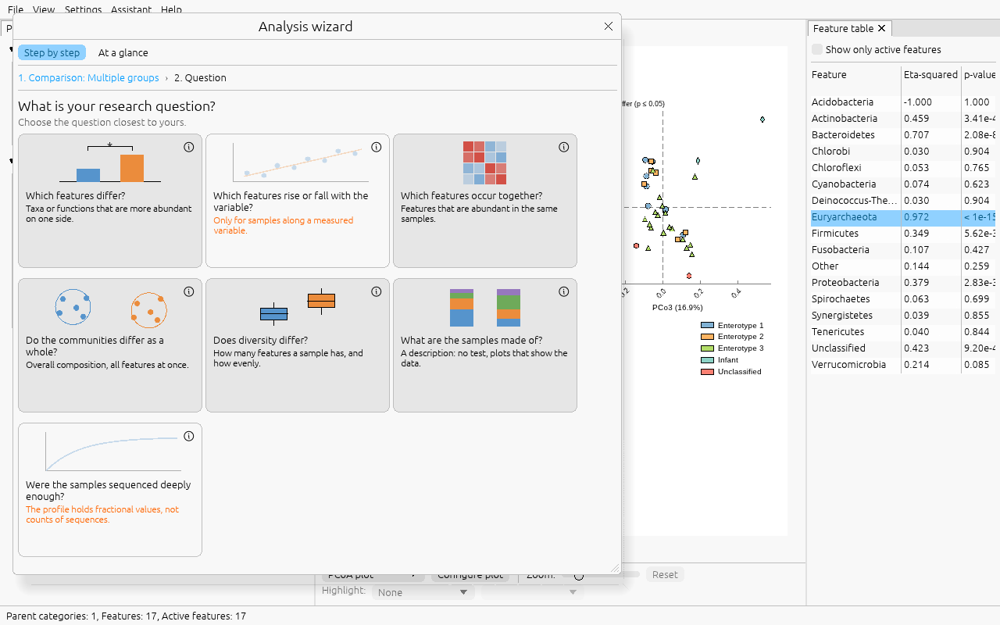
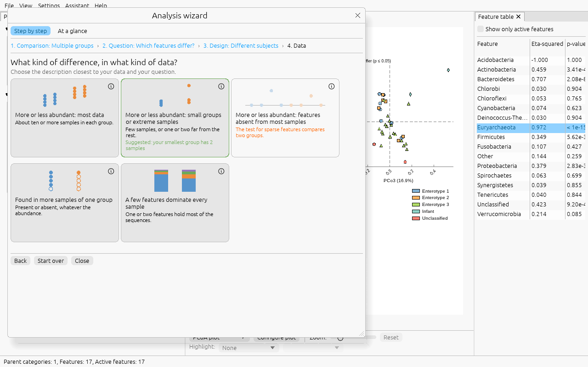
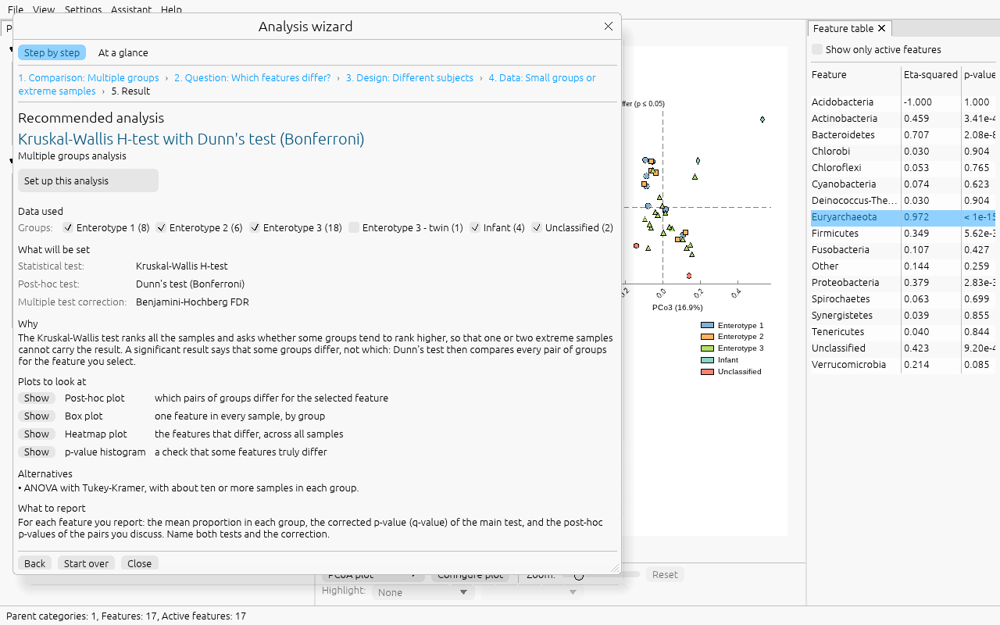
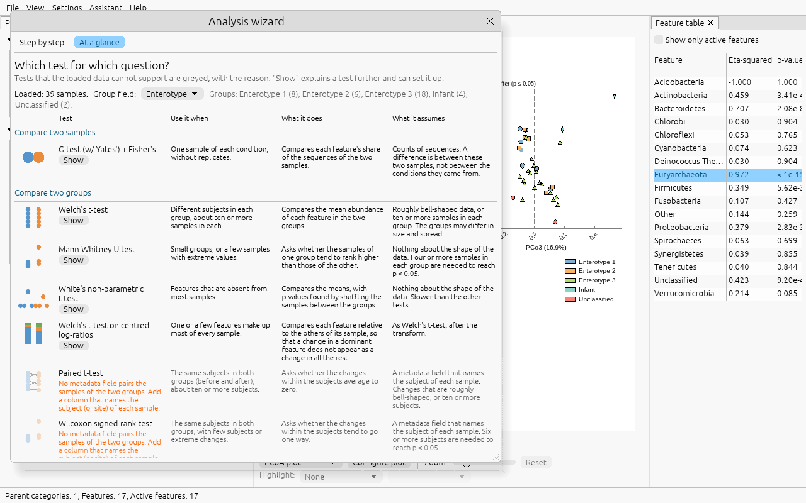

The analysis wizard
===================

The wizard asks a few questions about what you want to know and leads to
the analysis, statistical test and plots in STAMP that answer it. It is for
anyone who is unsure which test suits their data; it chooses nothing that
cannot also be chosen by hand in the Statistics panel. Open it with **Assistant >
Analysis wizard**, or with the *Analysis wizard* button at the top of the
Statistics panel.

Every choice is always shown. A choice that the loaded data cannot support
is greyed and says why (for example, "No metadata field holds a number"),
so that the wizard also shows what a data set would need for an analysis.
Each choice has a small drawing of what it means and an **i** button with
a longer explanation and an example: pointing at it shows the explanation,
and clicking it shows it above the choices until closed.

   The second question, for the enterotype example. Two questions are
   greyed: the samples have no measured variable, and the profile holds
   proportions rather than counts of sequences.

The questions
-------------

1. **What are you comparing?**

   * *Two samples*: one sample of each condition, without replicates.
   * *Two groups*: several samples of each of two conditions.
   * *Multiple groups*: several samples of each of three or more
     conditions.
   * *Samples along a measured variable*: each sample has a number (pH,
     age, depth) in the metadata.

   The **parent level** (what each feature's proportion is a proportion
   of), the **profile level** (the level of the hierarchy whose features
   are compared) and the **group field** can be changed at the top of this
   step; the groups and their sizes are listed beside them. The **i**
   beside each explains it, as the **i** on a choice does.

2. **What is your research question?**

   * *Which features differ?*
   * *Which features rise or fall with the variable?*
   * *Which features occur together?*
   * *Do the communities differ as a whole?*
   * *Does diversity differ?*
   * *What are the samples made of?* (a description, with no test)
   * *Were the samples sequenced deeply enough?*

   Only "Which features differ?" between groups needs the two further
   questions; every other question leads straight to a recommendation.

3. **Were the same subjects sampled in every group?** Different subjects in
   each group (patients and controls), or the same subjects in every group
   (before and after a treatment). The second can be chosen when a metadata
   field names the subject of each sample; the wizard finds the fields that
   do, and how many subjects each one matches.

4. **What kind of difference, in what kind of data?**

   * *More or less abundant: most data* (about ten or more samples in each
     group).
   * *More or less abundant: small groups or extreme samples.*
   * *More or less abundant: features absent from most samples.*
   * *Found in more samples of one group* (presence, whatever the
     abundance).
   * *A few features dominate every sample.*

   STAMP counts the samples of your smallest group (or the subjects your
   groups share) and marks one of the first two answers as **suggested**,
   with the number it is based on. You can still choose another.

   The fourth question. The smallest enterotype has two samples, so the
   rank-based tests are suggested; the test for sparse features is greyed
   because it compares two groups only.

The answers so far are listed along the top of the window; click one to
return to its question. *Back* returns to the previous question and *Start
over* to the first.

The recommendation
------------------

The last page names the recommended test (or, for a question without a
test, the plot), and gives:

* **Data used**: the data the analysis compares, each a drop-down box (or
  tick boxes) of the choices the loaded data allow: the two samples; the two
  groups and, for a paired test, the field that pairs them; the groups
  compared (at least three) and, for matched groups, the field that names
  the subjects; or the numeric field the features are correlated with.
  When a recommended plot shows a single feature (the bar, box, post-hoc
  and correlation scatter plots), **Feature** chooses it from every feature
  at the profile level; type in the search box at the top of its list to
  keep the features whose names contain what is typed, and press Enter to
  choose the first. The feature is selected in the Feature table too. Changing
  one changes the Statistics panel (or the selected feature) at once, and
  the recommendation follows it.
* **What will be set**: the test, the post-hoc test, any transform, and
  the multiple test correction.
* **Why** this test suits the answers given, in a paragraph, and anything
  the analysis cannot show.
* **Plots to look at**, each with what it is for.
* **Alternatives**, and when to prefer them.
* **What to report** in a paper.

   The recommendation for small groups: the Kruskal-Wallis H-test with
   Dunn's test.

**Set up this analysis** chooses those settings in the Statistics panel,
runs the analysis and shows the first of the plots. The wizard stays open,
in front of the other windows, so that *Show* beside another plot can show
that plot; **Close** at its bottom closes it. **Assistant > Undo
assistant's last change** (or *Undo assistant's change* in the status bar)
puts back the analysis and plot as they were before the wizard set them up,
including the profile level and data chosen in the wizard, as it does for an
AI assistant's changes. For a test of many
features the wizard always chooses the Benjamini-Hochberg FDR correction;
everything it sets can be changed afterwards in the Statistics panel. The
two samples, or the two groups, compared are those chosen there.

For multiple groups with "most data", the wizard chooses between ANOVA
with Tukey-Kramer and Welch's ANOVA with Games-Howell from the data. Before
recommending, it runs the Brown-Forsythe test of equal spread on every
feature of the ticked groups (on the centred log-ratios when it will apply
that transform). It recommends Welch's ANOVA if the groups differ twofold
or more in size, or if the spread of more than 10% of the features differs
(p < 0.05; about 5% would by chance), and the *Why* paragraph gives the
count and the reason either way, for example "Brown-Forsythe test: the
spread differs between the groups for 673 of 1392 features (48%; p < 0.05,
5% expected by chance)." (see :ref:`equal-spread`).

The tests at a glance
---------------------

**At a glance**, at the top of the wizard, shows the same tests as one
table instead of as questions: a row for each test, under what it is for
(compare two samples, two groups, three or more groups, presence or
absence, find relationships, compare whole communities), with when to use
it, what it does and what it assumes. It suits those who already have a
test in mind and want to check that it fits, or to see what else there is.

   The start of the table for the enterotype example. The paired tests are
   greyed: no metadata field says which samples came from the same subject.

As with the questions, a test that the loaded data cannot support is greyed
and says why. *Show* beside a test opens its recommendation, the same page
the questions lead to, from which the analysis can be set up. A test that
suits two groups or more (PERMANOVA, for example) is set up for multiple
groups if the group field has three or more groups, and otherwise for two.
**Step by step** returns to the questions.

Where each path leads
---------------------

.. list-table::
   :header-rows: 1
   :widths: 22 39 39

   * - Comparison
     - Answers
     - Recommendation
   * - Two samples
     - Which features differ?
     - G-test (w/ Yates') + Fisher's
   * - Two groups
     - Different subjects; most data
     - Welch's t-test
   * -
     - Different subjects; small groups or extreme samples
     - Mann-Whitney U test
   * -
     - Different subjects; features absent from most samples
     - White's non-parametric t-test
   * -
     - Different subjects; found in more samples
     - Fisher's exact test (presence/absence)
   * -
     - The same subjects; most data
     - Paired t-test
   * -
     - The same subjects; small groups or extreme samples
     - Wilcoxon signed-rank test
   * -
     - The same subjects; found in more samples
     - McNemar's test (presence/absence)
   * - Multiple groups
     - Different subjects; most data
     - ANOVA with Tukey-Kramer; Welch's ANOVA with Games-Howell if the
       groups differ twofold in size, or the spread of over 10% of the
       features differs (Brown-Forsythe test)
   * -
     - Different subjects; small groups or extreme samples
     - Kruskal-Wallis H-test with Dunn's test
   * -
     - Different subjects; found in more samples
     - Chi-square test (presence/absence)
   * -
     - The same subjects
     - Friedman test with Wilcoxon signed-rank (Holm)
   * - Two or multiple groups
     - A few features dominate
     - The test for "most data" (or the matched test), with the centred
       log-ratio transform; the ANCOM plot as confirmation
   * -
     - Which features occur together?
     - Co-occurrence heatmap
   * -
     - Do the communities differ?
     - PCoA plot with PERMANOVA, ANOSIM and PERMDISP (and pairwise
       PERMANOVA for multiple groups); NMDS and distance box plots
   * -
     - Does diversity differ?
     - Alpha diversity plot with a Mann-Whitney (two groups) or Kruskal-Wallis
       H-test (more)
   * -
     - What are the samples made of?
     - Composition bar plot, heatmaps, prevalence-abundance, shared
       features, rank-abundance, map
   * -
     - Sequenced deeply enough?
     - Rarefaction curves
   * - Measured variable
     - Which features rise or fall?
     - Spearman rank correlation
   * -
     - Which features occur together?
     - Co-occurrence heatmap
   * -
     - Do the communities differ?
     - Mantel test plot
   * -
     - Does diversity differ?
     - Alpha diversity scatter plot

The reasons behind these choices are given in :doc:`choosing_a_test`, and
the tests themselves are explained in :doc:`statistics`.
